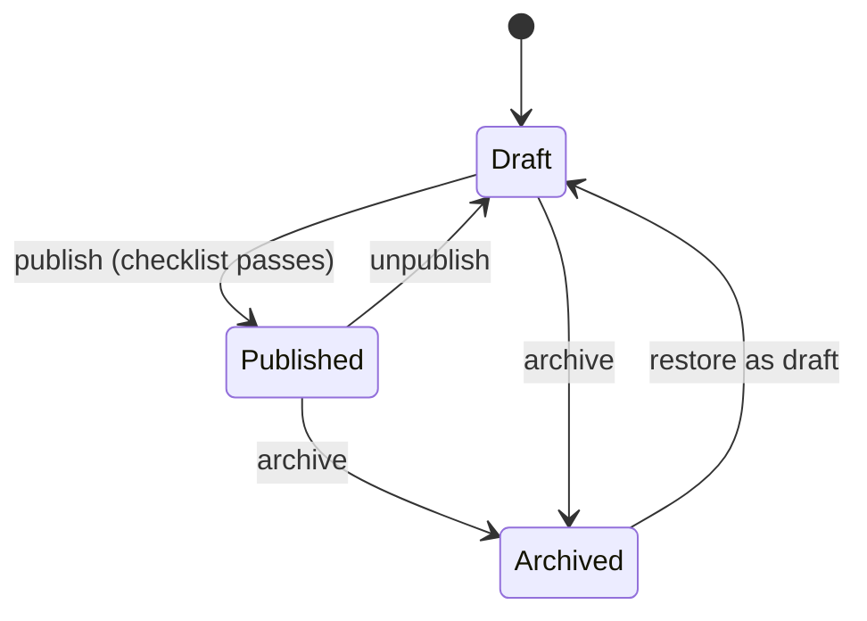
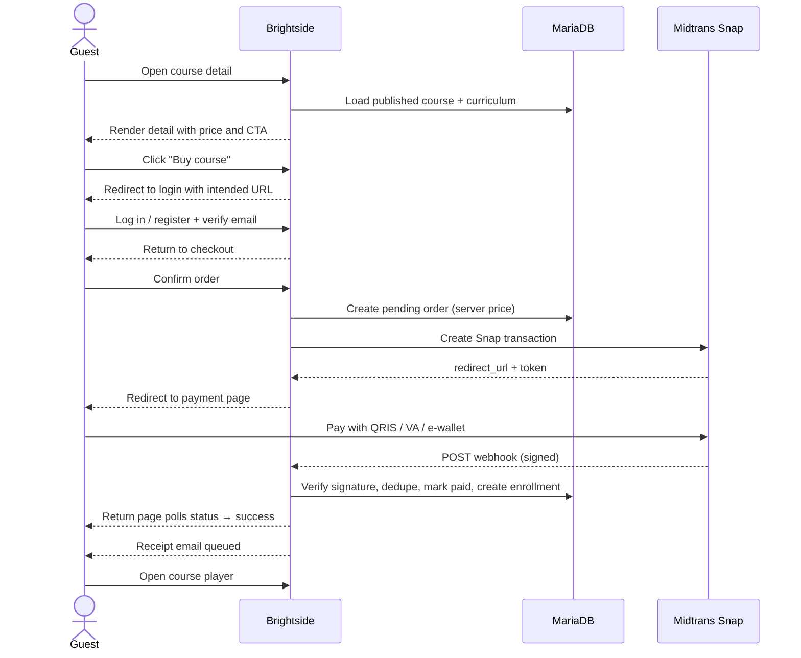
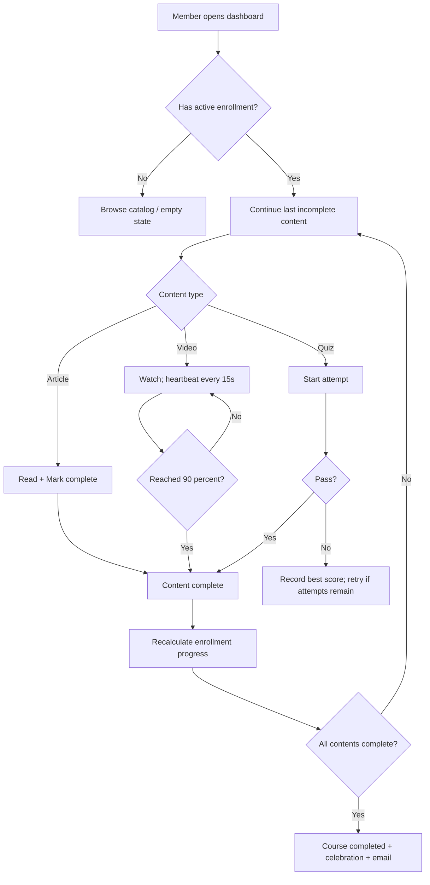
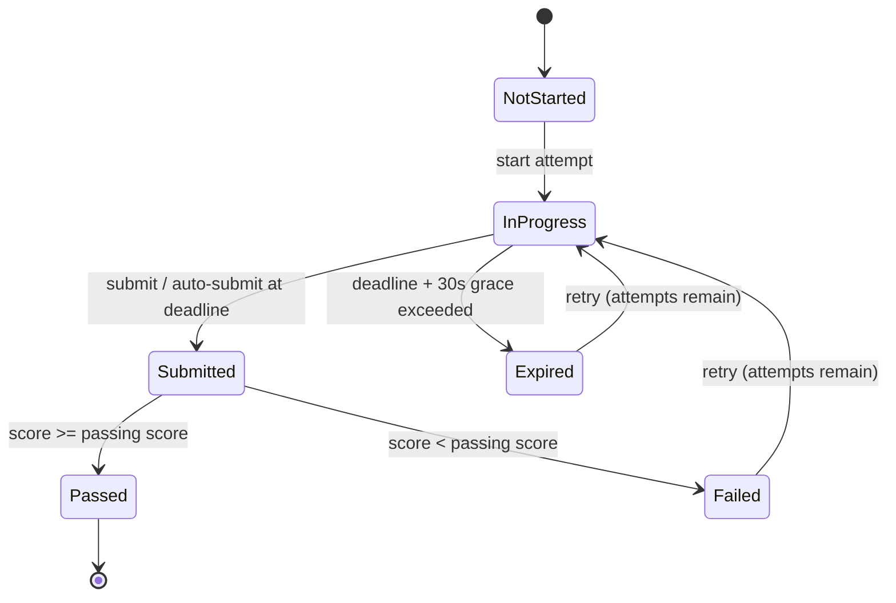
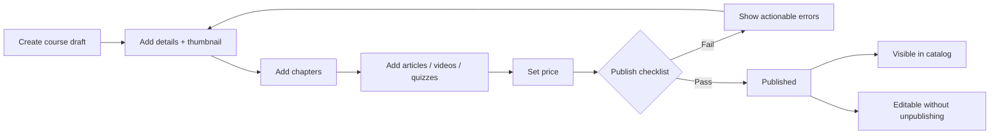
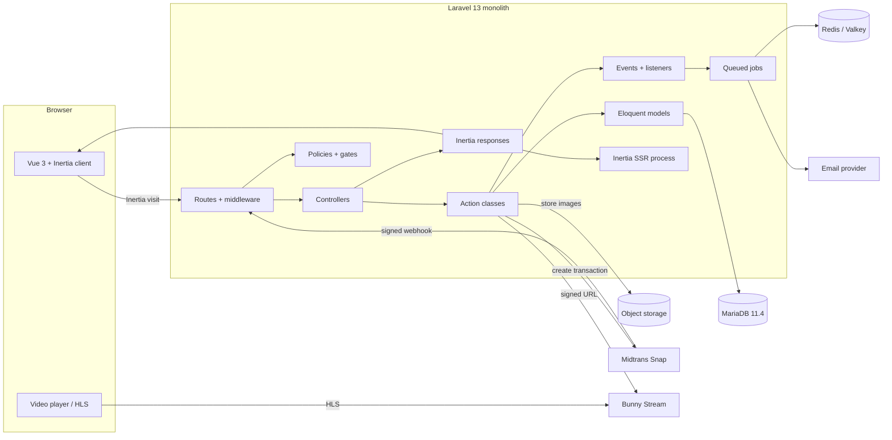
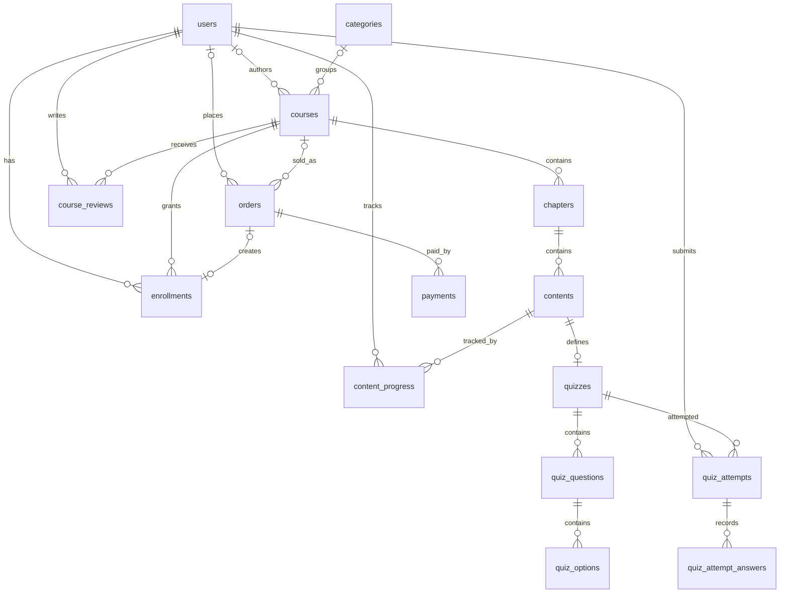

# Brightside — Product Requirements & Technical Guide

**An e-learning platform for self-paced, paid courses.**

| Field | Value |
| --- | --- |
| Document version | 1.0 |
| Status | Ready for implementation |
| Last updated | 20 October 2026 |
| Supersedes | `requirements.md` v0.1 (original brief) |
| Audience | Product, design, engineering, QA, operations |
| Working product name | Brightside (replace with final brand after trademark check) |
| Primary market assumption | Indonesia, IDR pricing, English UI with Indonesian content support |

> **How to use this document.** Sections 1–8 define what to build and why. Section 9 defines how it should look and feel. Sections 10–15 define how to build, test, and ship it. Every functional requirement has an ID (`AUTH-01`, `CHK-04`, etc.) so it can be traced into issues, pull requests, and tests. Items marked **Must** are required for the first public release. **Should** items are included when schedule allows. **Could** and **Phase 2/3** items are explicitly out of the first release.

---

## Table of contents

1. [Executive summary](#1-executive-summary)
2. [Vision, goals, and success metrics](#2-vision-goals-and-success-metrics)
3. [Personas, roles, and permissions](#3-personas-roles-and-permissions)
4. [Scope and release plan](#4-scope-and-release-plan)
5. [Glossary](#5-glossary)
6. [Functional requirements](#6-functional-requirements)
7. [Business rules and state machines](#7-business-rules-and-state-machines)
8. [Information architecture, routes, and UX flows](#8-information-architecture-routes-and-ux-flows)
9. [Design guide](#9-design-guide)
10. [Technical architecture](#10-technical-architecture)
11. [Database design](#11-database-design)
12. [Key technical flows](#12-key-technical-flows)
13. [Security, privacy, and compliance](#13-security-privacy-and-compliance)
14. [Testing strategy](#14-testing-strategy)
15. [Delivery, environments, and operations](#15-delivery-environments-and-operations)
16. [Risks and mitigations](#16-risks-and-mitigations)
17. [Decisions to confirm](#17-decisions-to-confirm)
18. [Appendices](#18-appendices)

---

## 1. Executive summary

Brightside is a web-based e-learning platform where administrators publish courses for sale and registered members buy and complete them at their own pace.

A course is the top-level product. Each course contains ordered **chapters**, and each chapter contains ordered **contents**. A content is exactly one of three types:

- **Article** — Markdown theory with a reading layout.
- **Video** — hosted lesson video with resume and watch-progress tracking.
- **Quiz** — single-choice questions with a passing score and attempt limits.

Members see progress at three levels: per content, per chapter, and per course. Course progress is the share of course contents completed; chapter progress is derived from its contents. Completed courses can later issue certificates without changing the learning model.

The first release is a **modular monolith**: Laravel 13 + Inertia.js v3 + Vue 3 + TypeScript on the front end, MariaDB for persistence, Tailwind CSS v4 and shadcn-vue for the interface. Payments go through Midtrans (Indonesia) behind a small gateway contract. Videos are hosted externally and delivered through signed URLs. The application is server-rendered for public catalog pages so courses are indexable.

The design direction is **"bright studio"**: warm paper surfaces, near-black ink, electric cobalt, tangerine, and mint; chunky but disciplined geometry; playful hover moments; strict grids and readable typography. It should feel like a well-designed creative classroom, not a corporate LMS and not a children's app.

### Source brief traceability

| Original statement | Where it is specified |
| --- | --- |
| Admin provides several courses for sale | `ADM-02`–`ADM-09`, `CHK-01`–`CHK-12` |
| Registered members buy courses | `AUTH-01`–`AUTH-05`, `CHK-01`–`CHK-12`, `ENR-01`–`ENR-04` |
| Course → many chapters → many contents | `ADM-04`, `LRN-03`; schema in sections 11.4–11.6 |
| Article, video, and quiz content types | `LRN-04`–`LRN-06`, `QUIZ-01`–`QUIZ-12`; schema in sections 11.6–11.9 |
| Member progress by cleared contents/chapters | `LRN-09`–`LRN-14`; schema in sections 11.10–11.13 |
| Fun, modern, disciplined visual direction | Section 9, especially 9.2–9.8 |

---

## 2. Vision, goals, and success metrics

### 2.1 Problem

Independent educators and small course businesses need a storefront and a learning experience in one product. Generic LMS platforms feel administrative; generic checkout tools do not understand chapters, quizzes, or progress. Members, in turn, need a clear answer to three questions at all times:

1. What should I learn next?
2. How much have I completed?
3. What did I get for my money?

### 2.2 Vision

> Make buying and finishing a course feel as clear and satisfying as crossing items off a well-designed checklist.

### 2.3 Product principles

1. **Progress is always visible.** Every course surface answers "how far am I?" without requiring a report.
2. **One obvious next action.** Continue, start, buy, or preview — never a wall of equivalent buttons.
3. **Admin speed matters.** A course author should go from blank course to published curriculum without leaving one editing flow.
4. **Playful, not childish.** Personality comes from color, type, and motion, not from clutter or emoji.
5. **Trust is a feature.** Clear pricing, receipts, access rules, and refund handling are part of the learning experience.
6. **Boring where it counts.** Payments, authorization, and progress calculations are deterministic and well tested.

### 2.4 Goals and success metrics

| Goal | Metric | Target (first 90 days) |
| --- | --- | --- |
| Members find a course worth buying | Course-detail → checkout conversion | ≥ 3% |
| Members start learning quickly | Registered members enrolled within 7 days | ≥ 40% |
| Members finish what they start | Enrollments reaching 100% | ≥ 30% |
| Learning becomes a habit | Weekly active learners / enrolled members | ≥ 50% |
| Checkout is reliable | Paid orders / initiated orders | ≥ 95% |
| Experience is fast | Public page LCP on 4G | < 2.5 s |
| Experience is stable | 5xx rate | < 0.5% |
| Support load stays low | Payment-related support tickets | < 2% of orders |

Targets are initial hypotheses; review them after the first cohort of 100 paying members.

### 2.5 Non-goals for the first release

- Multi-vendor marketplace or instructor payouts.
- Live classes, cohorts, or scheduled sessions.
- Subscriptions, memberships, or bundled course plans.
- Multi-item shopping cart (one course per order).
- Native mobile apps.
- Offline downloads.
- User-generated course authoring.
- Affiliate program.
- Drip/scheduled content release.
- Organization/team accounts.
- Localized UI beyond English in the first release (content itself may be in any language).

---

## 3. Personas, roles, and permissions

### 3.1 Personas

**Rani, 24 — career switcher.** Studies on a phone during commutes. Wants short videos, clear chapter progress, and an affordable one-time price. Abandons flows that ask for too much before showing value.

**Bagus, 31 — upskilling professional.** Studies on a laptop after work. Buys a course because the curriculum is specific. Expects quizzes, resume-where-you-left-off, and a receipt for reimbursement.

**Maya, 35 — platform administrator and course author.** Builds courses, uploads videos, writes quizzes, watches sales. Needs a fast curriculum builder and confidence that publishing will not break existing learners.

### 3.2 Roles

The first release has exactly two roles. A dedicated instructor role is deliberately deferred; the admin who creates a course is displayed as its instructor.

| Role | Description |
| --- | --- |
| **Guest** | Unauthenticated visitor. Can browse the catalog, view course details, and view free-preview contents. |
| **Member** | Registered, email-verified user. Can buy or enroll in courses, learn, take quizzes, track progress, and view own orders. |
| **Admin** | Platform operator. Can manage courses, curriculum, categories, orders, and members, and preview any course. Admins also have member capabilities. |

### 3.3 Permission matrix

| Capability | Guest | Member | Admin |
| --- | :---: | :---: | :---: |
| Browse published catalog and course details | Yes | Yes | Yes |
| View free-preview article/video | Yes | Yes | Yes |
| Register, log in, reset password | Yes | — | — |
| Buy a course / enroll for free | No (redirect to login) | Yes | Yes |
| Access enrolled course contents | No | Yes | Yes |
| Submit quiz attempts | No | Yes | Yes |
| Track and view own progress | No | Yes | Yes |
| View own orders and receipts | No | Yes | Yes |
| Preview any course without enrollment | No | No | Yes |
| Create, edit, publish, archive courses | No | No | Yes |
| Manage curriculum and quizzes | No | No | Yes |
| Manage categories | No | No | Yes |
| View all orders and members | No | No | Yes |
| Grant or revoke enrollment | No | No | Yes |
| Refund an order | No | No | Yes |
| Manage platform settings | No | No | Yes |

**Authorization rules**

- Every admin route requires `auth`, `verified`, and an `access-admin` gate.
- Admin routes live under `/admin` and are never linked from member navigation unless the user is an admin.
- A member can only read their own orders, attempts, progress, and profile. Route model binding alone is never sufficient; every read and write goes through a policy.
- Admins can preview courses but do not receive an enrollment or progress record from previewing.
- The last remaining admin cannot be demoted or deleted.

---

## 4. Scope and release plan

### 4.1 Release phases

| Phase | Name | Contents | Exit criteria |
| --- | --- | --- | --- |
| **0** | Foundation | MariaDB, auth with registration and verification, roles, design tokens, layouts, CI | A member can register, verify, log in, and see a themed dashboard |
| **1** | Catalog and authoring | Categories, courses, chapters, contents, quiz builder, publish workflow, public catalog and detail pages, free previews | An admin can publish a complete course; a guest can browse it and preview free content |
| **2** | Commerce | Checkout, Midtrans, webhooks, enrollment, receipts, expiry, reconciliation, refunds | A member can pay and immediately access the course; webhook replay creates no duplicates |
| **3** | Learning | Player, article/video/quiz experiences, progress engine, dashboard, my courses, quiz attempts | A member can complete every content type and see correct course/chapter progress |
| **4** | Launch polish | Admin analytics, emails, SEO/SSR, accessibility pass, performance pass, test suite, deployment | All Must requirements pass the release checklist |

### 4.2 MoSCoW summary

| Priority | Items |
| --- | --- |
| **Must** | Auth and verification, roles, mandatory admin 2FA, catalog, course detail, free preview, admin course/curriculum authoring, quiz builder, publish/archive, paid and free enrollment, Midtrans checkout, webhook idempotency, receipt email, player, three content types, progress tracking, quiz attempts, dashboard, order history, audit writes for refunds/grants/revokes, access control, responsive UI, WCAG AA basics, SEO basics, tests, deployment |
| **Should** | Admin sales chart, completion email, related courses, search empty-state suggestions |
| **Could** | Course reviews, in-app notifications, coupons, certificates, notes/bookmarks, social login, UI localization, duplicate course, video upload inside the app, audit log viewer |
| **Won't (this release)** | Subscriptions, live classes, multi-vendor, mobile apps, offline, Q&A/comments, affiliate, drip content |

### 4.3 Assumptions

- One currency per deployment (IDR by default).
- One course per order; no cart.
- Lifetime access after purchase, unless an admin sets an expiry date.
- Prices are one-time and tax-inclusive; no tax engine in the first release.
- Admin accounts are created by a seeder or Artisan command, not public registration.
- Course videos are hosted externally; the application stores references and signed playback URLs.
- Payment methods are whatever Midtrans Snap offers for the merchant account (QRIS, virtual account, e-wallet, card).
- English is the UI language; course content can be authored in Indonesian or English.

---

## 5. Glossary

| Term | Meaning |
| --- | --- |
| **Course** | A sellable learning product with metadata, price, status, chapters, and contents. |
| **Chapter** | An ordered grouping of contents inside a course. |
| **Content** | A single learning unit: article, video, or quiz. |
| **Article** | Markdown theory content, completed manually. |
| **Video** | Hosted lesson video, completed at the watch threshold. |
| **Quiz** | A set of single-choice questions with a passing score. |
| **Curriculum** | The ordered chapter/content tree of a course. |
| **Enrollment** | A member's right to access a course, created by purchase, free enrollment, or admin grant. |
| **Entitlement** | The authorization decision that a member may view a specific content. |
| **Progress** | Completion state of a content, chapter, or course for one member. |
| **Attempt** | One submission cycle of a quiz. |
| **Order** | A purchase record for one course. |
| **Payment** | A gateway transaction attached to an order. |
| **Free preview** | A content marked viewable without enrollment. |
| **Published** | Visible in the public catalog and purchasable. |
| **Archived** | Hidden from the catalog and not purchasable; existing enrollments retain access. |
| **Minor unit** | Integer amount in the currency's smallest chargeable unit. For IDR, 1 minor unit = Rp 1. |

---

## 6. Functional requirements

Priorities use MoSCoW. "Done when" is the minimum acceptance condition for the first release.

### 6.1 Authentication and account

| ID | Priority | Requirement | Done when |
| --- | --- | --- | --- |
| `AUTH-01` | Must | A visitor can register with name, email, password, password confirmation, and accepted terms. New accounts receive the `member` role. | Submitting valid data creates an unverified member and sends a verification email; duplicate email returns a field error. |
| `AUTH-02` | Must | Registration requires a valid, unique email address and a password that meets the configured policy. | Weak, mismatched, or duplicate credentials are rejected with field-level errors; valid data succeeds. |
| `AUTH-03` | Must | Members must verify their email before checkout or learning. Browsing remains available. | An unverified member is redirected to the verification notice on checkout/player routes and can resend the link. |
| `AUTH-04` | Must | A member can log in with email and password, optionally staying signed in. | Valid credentials create a session and redirect to the intended URL; invalid credentials return a generic error; login is rate-limited. |
| `AUTH-05` | Must | A member can log out from any authenticated page. | Session is invalidated and the user returns to the public home page. |
| `AUTH-06` | Must | A member can request a password reset link and set a new password from the emailed link. | Reset email is sent for known addresses; unknown addresses return the same generic response; token expiry and reuse are handled. |
| `AUTH-07` | Must | A member can update name, email, avatar, headline, and bio. Changing email requires re-verification. | Profile changes persist; a changed email resets `email_verified_at` and sends a new verification email. |
| `AUTH-08` | Must | A member can change their password by supplying the current password. | Wrong current password is rejected; the new password is hashed and other sessions remain valid unless "log out other devices" is chosen. |
| `AUTH-09` | Must | A member can delete their account after confirming their password. | Account is deleted, enrollments and progress are removed, and order history retains the accounting snapshot, with direct identifiers minimized where legally permitted. |
| `AUTH-10` | Must | Admin accounts must use two-factor authentication before production launch. | An admin without confirmed 2FA is forced through setup before reaching `/admin`; recovery codes are available. |
| `AUTH-11` | Must | Admin accounts are provisioned only by seeder/Artisan command. Public registration always creates members. | A crafted `role=admin` registration payload creates a member, never an admin. |
| `AUTH-12` | Should | A member can enable or disable 2FA from security settings. | TOTP setup, confirmation, recovery codes, and disable-with-password all work. |
| `AUTH-13` | Could | Google social login. | Deferred to Phase 2. |
| `AUTH-14` | Could | Passkey login. | Deferred to Phase 3. |

**Validation and policy**

- Name: 2–120 characters.
- Email: valid, normalized to lowercase, max 190 characters, unique.
- Password: minimum 10 characters with mixed case and a number by default; configurable through `Password::defaults()`.
- Terms acceptance: required boolean, recorded with timestamp and policy version.
- Login throttle: 5 attempts per minute per email + IP.
- Registration throttle: 3 attempts per minute per IP.
- Password reset throttle: 3 requests per minute per email + IP.
- Session lifetime: 120 minutes; "remember me" 30 days.
- Email verification link expires according to Laravel's signed URL lifetime (60 minutes by default).
- Account deletion requires password confirmation and a typed confirmation phrase.

### 6.2 Public catalog and discovery

| ID | Priority | Requirement | Done when |
| --- | --- | --- | --- |
| `CAT-01` | Must | The home page presents the value proposition, category shortcuts, featured courses, and a primary catalog CTA. | A guest can reach the catalog in one click from the hero; featured courses are published only. |
| `CAT-02` | Must | The catalog lists published courses with pagination (12 per page). Draft and archived courses never appear. | Direct queries and filters return only `published` courses; page 2 preserves filters. |
| `CAT-03` | Must | The catalog can be searched by title and subtitle. | Search is case-insensitive, escapes `%` and `_`, trims input, and shows a useful empty state. |
| `CAT-04` | Must | The catalog can be filtered by category, level, and price type (free/paid), and sorted by newest, most popular, and price. | Filters combine correctly, invalid values are ignored safely, and the active filters are visible and removable. |
| `CAT-05` | Must | Each course card shows thumbnail, title, subtitle, category, level, duration, content count, price (or "Free"), and a status badge when applicable. | Card is fully keyboard reachable and the entire card is a link with a visible focus ring. |
| `CAT-06` | Must | The course detail page shows title, subtitle, description, learning outcomes, requirements, instructor, curriculum, duration, content count, level, language, price, and purchase/preview actions. | Every field renders safely; missing optional fields collapse without layout gaps. |
| `CAT-07` | Must | The curriculum on the course detail page is grouped by chapter and shows content type, estimated duration, and free-preview badges. | Chapters are ordered by position; contents are ordered by position; no draft-only leakage. |
| `CAT-08` | Must | Contents marked `is_free_preview` are viewable by guests without enrollment. | A guest can open a free-preview article/video; a non-preview content redirects to the course page with a clear message. Quizzes cannot be free previews. |
| `CAT-09` | Must | The course detail CTA adapts to viewer state: guest → login to buy; member not enrolled → buy/enroll; enrolled → continue; archived → unavailable. | Each state renders exactly one primary action. |
| `CAT-10` | Must | Archived courses are hidden from the catalog and return 404 publicly; enrolled members and admins can still access them. | Public request returns 404; enrolled member opens the player; admin can preview. |
| `CAT-11` | Must | Empty, loading, and error states exist for the catalog, search, and course detail. | Skeleton loaders match the final layout; empty states suggest clearing filters or browsing all courses. |
| `CAT-12` | Should | Related courses are shown on the course detail page. | Same category, published, excluding current course, max 3. |
| `CAT-13` | Should | The catalog supports `prefetch` on course links for perceived speed. | Hover/focus prefetch does not trigger duplicate analytics or data loading. |
| `CAT-14` | Must | Public pages are server-rendered and expose canonical, Open Graph, and JSON-LD `Course` metadata. | `curl` returns rendered content and valid meta tags; sitemap includes published courses. |
| `CAT-15` | Could | Course ratings and reviews. | Deferred to Phase 2. |
| `CAT-16` | Could | Full-text search using MariaDB `MATCH ... AGAINST`. | Deferred until the catalog exceeds ~5,000 courses. |

**Derived badges.** Badges are computed from data, not stored: Free when the price is 0; New when the course was published within 14 days; Bestseller when it ranks in the top 10% of enrollments and has at least 20 enrollments. At most one badge is shown on a card, in that priority order.

### 6.3 Course detail content model

A course detail page is composed of:

1. **Hero** — title, subtitle, category, level, language, duration, content count, instructor, primary CTA, thumbnail/trailer.
2. **Outcomes** — 4–8 short "what you will be able to do" statements.
3. **Requirements** — 0–8 prerequisites.
4. **Curriculum** — chapters and contents, with free-preview markers.
5. **Instructor** — name, headline, bio, avatar (from the authoring admin).
6. **Description** — long-form Markdown.
7. **Purchase card** — sticky on desktop; price, one-time payment note, lifetime access note, CTA, secure-payment note.
8. **Related courses** — optional.

**Content display rules**

- Articles show an estimated reading time.
- Videos show duration when known.
- Quizzes show question count and passing score.
- Free-preview badges are visible on the curriculum.
- A content that belongs to an unpublished course is never publicly visible.

### 6.4 Checkout and payments

| ID | Priority | Requirement | Done when |
| --- | --- | --- | --- |
| `CHK-01` | Must | A guest clicking buy is sent to login/registration and returned to the course or checkout afterward. | Intended URL survives login and registration. |
| `CHK-02` | Must | A verified member can open a checkout page for a published paid course. | Checkout shows course, price, total, terms, and payment CTA; unverified members are redirected to verification. |
| `CHK-03` | Must | The server creates an order with a server-computed price; client-supplied prices are ignored. | Tampering with the request cannot change `subtotal_minor`, `total_minor`, or `course_id`. |
| `CHK-04` | Must | Creating an order returns a payment redirect URL from Midtrans Snap. | The member is redirected to the gateway; no card data touches the application. |
| `CHK-05` | Must | If a pending order for the same member and course exists and is not expired, it is reused instead of creating a duplicate. | Double-clicking "Pay" produces one pending order and one gateway transaction. |
| `CHK-06` | Must | A payment webhook verifies the gateway signature before changing any state. | Invalid signatures return 403 and leave orders untouched. |
| `CHK-07` | Must | Webhook processing is idempotent. Replayed or duplicate notifications never create a second payment, enrollment, or receipt. | Replaying the same payload twice leaves exactly one paid order, one active enrollment, and one receipt email. |
| `CHK-08` | Must | A paid notification marks the order paid, records the payment, creates or reactivates the enrollment, and queues a receipt. | Member immediately has access and sees the order as paid. |
| `CHK-09` | Must | The return page polls order status and shows success, pending, failed, or expired states without trusting the client. | Refreshing the page is safe; the server is the source of truth. |
| `CHK-10` | Must | Pending orders expire after 24 hours; expired orders cannot be paid through the app. | Scheduled job marks them expired; a late successful gateway notification is handled by reconciliation policy. |
| `CHK-11` | Must | A scheduled reconciliation job queries the gateway for stale pending orders and applies the authoritative status. | A missed webhook still results in the correct order/enrollment state within 15 minutes. |
| `CHK-12` | Must | An admin can refund a paid order with a reason. | Order becomes refunded; enrollment is revoked when no other paid order covers the course; the action is recorded. |
| `CHK-13` | Must | A free course can be enrolled in without payment. | `price_minor = 0` creates an enrollment with source `free`, no order, and no gateway call. |
| `CHK-14` | Must | A member can view order history and a receipt page with order number, course, amount, status, and date. | Only the owner or an admin can view an order; receipt is printable. |
| `CHK-15` | Must | A paid order sends a branded receipt email. | Email is queued, includes order number and course, and has a text fallback. |
| `CHK-16` | Could | Coupons and discounts. | Deferred to Phase 2. |
| `CHK-17` | Could | Tax breakdown and tax-inclusive invoicing. | Deferred to Phase 2. |
| `CHK-18` | Won't | Multi-course cart. | One course per order in this release. |

**Checkout copy requirements**

- State clearly: "One-time payment. Lifetime access."
- State the currency and exact amount, formatted for the locale (`Rp 149.000`).
- State that access is granted after payment confirmation.
- Link to terms and refund policy.
- Never use dark patterns: no pre-checked upsells, no hidden fees, no fake countdowns.

### 6.5 Enrollment and access control

| ID | Priority | Requirement | Done when |
| --- | --- | --- | --- |
| `ENR-01` | Must | An enrollment is created when an order is paid, when a free course is claimed, or when an admin grants access. | Enrollment has a source (`purchase`, `free`, `grant`) and an optional order. |
| `ENR-02` | Must | A member has at most one enrollment per course. Repurchasing after a refund reactivates the existing row. | Unique `(user_id, course_id)` holds; reactivation preserves progress. |
| `ENR-03` | Must | Enrollment grants access to every content in the course, including when the course is archived. | Access checks pass for enrolled members and fail for everyone else except free previews/admins. |
| `ENR-04` | Must | Access is enforced on the server for every player, content, quiz, and progress request. | Direct URL access by a non-enrolled member returns 403 or a redirect with an explanatory flash message. |
| `ENR-05` | Must | Enrollment is lifetime by default; an optional `expires_at` can limit it. | Expired enrollment is denied access but retains historical progress. |
| `ENR-06` | Must | An admin can grant enrollment without payment, with a required reason. | Enrollment source is `grant`; member immediately has access. |
| `ENR-07` | Must | An admin can revoke enrollment. | `revoked_at` is set; access is denied; progress is retained for audit/support. |
| `ENR-08` | Must | Admins can preview any course without creating an enrollment. | Preview mode shows a persistent "Admin preview" banner and never writes progress. |
| `ENR-09` | Must | Enrollment status is checked on every request, not only when rendering the dashboard. | A revoked member cannot continue via a bookmarked player URL. |

### 6.6 Learning experience

| ID | Priority | Requirement | Done when |
| --- | --- | --- | --- |
| `LRN-01` | Must | The member dashboard shows a greeting, continue-learning card, enrolled courses with progress, and recommended published courses. | A new member sees an empty state with a catalog CTA; an active member sees the last incomplete content. |
| `LRN-02` | Must | "My courses" lists all active enrollments with progress, last accessed date, and a continue action. | Revoked/expired enrollments are excluded or clearly marked. |
| `LRN-03` | Must | The player has a persistent curriculum sidebar (chapters/contents), a main content area, and previous/next navigation. | Sidebar shows completion checks, current item, free-preview badges, and collapses into a drawer on mobile. |
| `LRN-04` | Must | Article contents render Markdown as safe HTML in a readable column with a "Mark complete" action. | Raw HTML is not executed; completing is idempotent; next content is suggested. |
| `LRN-05` | Must | Video contents render in a responsive player, resume from the last position, and track watch progress. | Position is saved at least every 15 seconds and on pause/unload; completion occurs at the configured threshold for player-tracked videos, or manually for provider embeds. |
| `LRN-06` | Must | Quiz contents render a start screen, question flow, timer (if set), submit confirmation, and result screen. | A member can pass, fail, review answers when enabled, and retry when attempts remain. |
| `LRN-07` | Must | Previous/next navigation follows curriculum order across chapter boundaries. | First content disables Previous; last content disables Next and shows course completion state. |
| `LRN-08` | Must | The player resumes at the last accessed content when opened from the dashboard or course card. | `last_accessed_at` and last incomplete content determine the resume target. |
| `LRN-09` | Must | A member can mark an article complete manually. | Completion is recorded once, updates progress, and shows a success state. |
| `LRN-10` | Must | Video progress is reported to the server with position and duration. | Server clamps values, ignores impossible durations, rate-limits updates, and never trusts a completion flag from the client. |
| `LRN-11` | Must | Course progress equals completed contents divided by total contents, rounded to the nearest whole percent. | Progress is derived from completion records, not from client state. |
| `LRN-12` | Must | A chapter is complete when all of its contents are complete. | Chapter count and per-chapter state are visible in the sidebar and course summary. |
| `LRN-13` | Must | A course is complete when every content is complete; `completed_at` is set once. | Completion triggers one congratulations state (and the completion email when enabled), not one per page load. |
| `LRN-14` | Must | Adding or removing curriculum content recalculates progress for affected enrollments. | A completed course becomes incomplete when new content is added; progress percentages update. |
| `LRN-15` | Must | Progress is visible on course cards, the dashboard, the player, and the course detail page for enrolled members. | All surfaces agree with the stored enrollment progress. |
| `LRN-16` | Must | The learning experience is usable on a 360 px viewport. | Sidebar becomes a drawer; controls remain reachable; video is not cropped. |
| `LRN-17` | Must | Completion is celebrated with a brief, reduced-motion-safe confirmation. | Confirmation is announced to screen readers and does not block navigation. |
| `LRN-18` | Could | Notes, bookmarks, and highlights. | Deferred to Phase 2. |
| `LRN-19` | Could | Offline downloads. | Not planned. |

### 6.7 Progress rules

The detailed rules live in section 7.3. The product-visible behavior is:

- Article: complete when the member presses **Mark complete**.
- Video: complete when the member has watched at least 90% of the known duration (configurable), or when the video is shorter than 30 seconds and reaches 100%.
- Quiz: complete only when an attempt passes the passing score.
- Course: complete when all contents are complete.
- Chapter: complete when all its contents are complete.
- Completed-content count never decreases except when curriculum changes remove completed content; adding new content can lower the percentage.

### 6.8 Quizzes

| ID | Priority | Requirement | Done when |
| --- | --- | --- | --- |
| `QUIZ-01` | Must | An admin can attach one quiz to a quiz-type content. | A content has at most one quiz; deleting the content deletes the quiz. |
| `QUIZ-02` | Must | A quiz has a passing score (0–100), optional max attempts, optional time limit, optional shuffling, and a "show answers after submit" flag. | Settings persist and are enforced server-side. |
| `QUIZ-03` | Must | A quiz has one or more single-choice questions, each with 2–6 options and exactly one correct option. | Publishing is blocked if any question is invalid. |
| `QUIZ-04` | Must | Questions and options are ordered and editable. | Reordering persists; positions are stable after reload. |
| `QUIZ-05` | Must | Starting a quiz creates an attempt with a server-side start time and attempt number. | Max-attempts rule is enforced before the attempt is created. |
| `QUIZ-06` | Must | Submitting answers validates that every answer belongs to the quiz and that exactly one option is selected per question. | Invalid or foreign option IDs are rejected with 422. |
| `QUIZ-07` | Must | The server computes the score from stored points; the client cannot submit a score. | Tampering with the payload cannot change the result. |
| `QUIZ-08` | Must | A passing attempt completes the quiz content; a failing attempt records the best score but does not complete it. | Progress updates only on pass. |
| `QUIZ-09` | Must | Time limits are enforced against the server start time, with a 30-second grace period for network latency. | Late submissions beyond grace are rejected; the client auto-submits at zero. |
| `QUIZ-10` | Must | A member can review past attempts and see which answers were wrong when review is enabled. | Correct answers are never included in the page payload before submission. |
| `QUIZ-11` | Must | An admin can see attempts, scores, and pass rates per quiz. | Admin quiz report lists member, attempt, score, pass/fail, and date. |
| `QUIZ-12` | Should | Question and option order can be shuffled per attempt. | Shuffle is stable for the attempt and does not break answer checking. |
| `QUIZ-13` | Could | Multiple-answer, true/false, and fill-in questions. | Deferred to Phase 2; true/false can be modeled with two options. |
| `QUIZ-14` | Could | Question banks and random draws. | Deferred to Phase 2. |

### 6.9 Admin: course and curriculum management

| ID | Priority | Requirement | Done when |
| --- | --- | --- | --- |
| `ADM-01` | Must | The admin dashboard shows total revenue, paid orders, active enrollments, completion rate, and recent orders. | Numbers are computed from the database and respect the selected date range (default 30 days). |
| `ADM-02` | Must | The admin can list, search, filter, and paginate courses by status and category. | Draft, published, and archived counts are visible. |
| `ADM-03` | Must | The admin can create and edit a course in one flow with details, curriculum, pricing, and publish steps. | Required fields validate; unsaved changes warn before navigation. |
| `ADM-04` | Must | The admin can add, rename, reorder, and delete chapters. | Order persists; deleting a chapter requires confirmation and warns about content loss. |
| `ADM-05` | Must | The admin can add, edit, reorder, and delete contents within a chapter. | Content type cannot be changed after creation (delete and recreate instead). |
| `ADM-06` | Must | The admin can author article Markdown with a preview, video references, and quiz settings. | Markdown preview is server-rendered and sanitized; video reference validates by provider. |
| `ADM-07` | Must | The admin can build quiz questions and options, mark exactly one correct option, and add explanations. | Invalid quizzes cannot be saved as publishable. |
| `ADM-08` | Must | Publishing runs a readiness checklist and blocks publication with actionable errors. | Checklist includes title, slug, description, thumbnail, category, at least one chapter, at least one content, valid price, and valid quizzes/videos. |
| `ADM-09` | Must | The admin can unpublish (back to draft) or archive a course. | Unpublish hides it from the catalog; archive preserves enrolled access. |
| `ADM-10` | Must | Deleting a course is allowed only when it has no enrollments or paid orders; otherwise the admin must archive it. | Destructive action is guarded and explained. |
| `ADM-11` | Must | The admin can preview a course exactly as a member would see it, without writing progress. | Preview banner is visible; quiz submissions are disabled or sandboxed. |
| `ADM-12` | Must | The admin can manage categories (name, slug, description, order). | Deleting a category with courses requires reassignment or is blocked. |
| `ADM-13` | Must | The admin can view and filter orders, open an order, resend a receipt, and refund with a reason. | All state changes are confirmed and audited. |
| `ADM-14` | Must | The admin can view and search members, their enrollments, progress, and orders. | PII is visible only to admins; no bulk export in the first release. |
| `ADM-15` | Must | The admin can grant or revoke enrollment with a reason. | Grant creates an active enrollment; revoke sets `revoked_at`. |
| `ADM-16` | Should | The admin can see a simple revenue/enrollment chart for the last 30 days. | Chart renders from aggregated data and works in both themes. |
| `ADM-17` | Could | Duplicate a course as a draft. | Phase 2. |
| `ADM-18` | Could | Audit log viewer. | Phase 2 viewer; audit records are written from the first release. |
| `ADM-19` | Must | Every admin mutation is authorized and validated server-side; UI hiding is never the only control. | Non-admin requests return 403; invalid payloads return 422. |

### 6.10 Notifications and emails

| ID | Priority | Requirement | Done when |
| --- | --- | --- | --- |
| `NTF-01` | Must | Verification email on registration and resend. | Queued, branded, link works, expired links can be resent. |
| `NTF-02` | Must | Password reset email. | Queued, branded, token expiry handled. |
| `NTF-03` | Must | Payment receipt on paid order. | Contains order number, course, amount, date, and support link. |
| `NTF-04` | Must | Enrollment confirmation after paid/free/grant. | Contains course title and a "Start learning" link. |
| `NTF-05` | Should | Course completion congratulations. | Sent once per enrollment completion. |
| `NTF-06` | Should | Payment failed/expired notice with retry link. | Sent when an order fails or expires; no duplicate sends. |
| `NTF-07` | Should | Admin new-sale notification. | One email or digest per paid order; configurable recipient. |
| `NTF-08` | Could | In-app notification center. | Phase 2. |
| `NTF-09` | Could | Email preferences. | Phase 2; transactional emails cannot be disabled. |

**Email rules**

- All transactional email is queued.
- Every email has a plain-text fallback.
- From name and address are configurable.
- Unsubscribe is not offered for transactional mail; it is offered for marketing only.
- Bounce/complaint handling is configured with the email provider.

### 6.11 Reviews, certificates, and coupons (post-launch)

These are specified now so the data model and UI do not block them later.

**Reviews (`Phase 2`)**

- A member who has completed at least one content may rate a course 1–5 and leave a comment.
- One review per member per course; editable.
- Reviews are moderated (pending/approved/rejected); only approved reviews are public.
- Course rating is the average of approved reviews.

**Certificates (`Phase 2`)**

- Issued automatically when a course is completed.
- Contains member name, course title, completion date, and a verification code.
- Downloadable as PDF and verifiable at `/certificates/{code}`.
- Revoked if the enrollment is revoked or the course is archived for cause.

**Coupons (`Phase 2`)**

- Percentage or fixed amount, optional course scope, usage limit, date window, minimum purchase.
- One coupon per order; discount is applied server-side and snapshotted on the order.
- Redemptions are unique per order; usage count increments atomically.

---

## 7. Business rules and state machines

### 7.1 Money and pricing

- Every deployment has one currency, configured as `app.currency` (default `IDR`).
- Amounts are stored as integers in the currency's smallest chargeable unit (`price_minor`, `total_minor`). For IDR, 1 minor unit = Rp 1; for USD, 1 minor unit = 1 cent.
- Formatting is centralized in a `Money` support class and a `useMoney` composable. No page formats amounts ad hoc.
- IDR is displayed as `Rp 149.000` using Indonesian thousands separators.
- A price of `0` means free. Free courses bypass checkout and create an enrollment directly.
- Course price changes affect only new orders. Existing orders keep their snapshotted amounts; existing enrollments keep access.
- The server always recomputes totals from the course record and server-side discount rules. A client-submitted amount is never trusted.
- Taxes are included in the displayed price in the first release. The order has a `tax_minor` field reserved for a future tax breakdown; it is `0` until tax rules are enabled.
- Refund amounts are the full order total in the first release. Partial refunds are Phase 2.

### 7.2 Order and payment state machine

**Order states**

| State | Meaning | Terminal |
| --- | --- | --- |
| `pending` | Created, awaiting payment | No |
| `paid` | Gateway confirmed payment; enrollment active | No (can be refunded) |
| `failed` | Gateway rejected or payment failed | Yes |
| `expired` | Payment window elapsed without success | No (late settlement exception) |
| `cancelled` | Cancelled by an admin before payment | Yes |
| `refunded` | Refunded by an admin | Yes |

**Allowed transitions**

| From | To | Trigger | Side effects |
| --- | --- | --- | --- |
| — | `pending` | Member starts checkout | Order + payment redirect created |
| `pending` | `paid` | Verified webhook or reconciliation says paid | Payment row, enrollment upsert, receipt, events |
| `pending` | `failed` | Gateway says deny/failure | Failure email |
| `pending` | `expired` | Expiry job after 24 hours | Expiry email |
| `expired` | `paid` | Verified late settlement | Payment row, enrollment, discrepancy flag |
| `pending` | `cancelled` | Admin cancels | No enrollment |
| `paid` | `refunded` | Admin refund with reason | Revoke enrollment if uncovered, refund record |
| `paid` | `paid` | Duplicate webhook | No-op (idempotent) |
| `refunded` | — | Any | No further transitions |

**Rules**

- A late successful payment notification for a locally expired order is honoured: the order becomes `paid` and the member is enrolled, because the gateway is authoritative for money movement. The reconciliation job flags the discrepancy.
- A refund notification from the gateway is applied only if the order is not already refunded.
- Only one non-terminal pending order per member + course is reused. A new order may be created after the previous one is failed, expired, or cancelled.
- Order numbers are human-readable and unique: `BS-YYYYMMDD-XXXXXX` where `XXXXXX` is Crockford Base32 derived from a ULID suffix. Generation retries on collision.
- The order snapshots `course_title`, `customer_name`, and `customer_email` so history survives course or account deletion. Retain these as accounting records and minimize direct identifiers where legally permitted.
- Payment rows are append-only: a webhook may advance the status of an existing payment reference, but rows are never deleted.

### 7.3 Progress rules (authoritative)

Definitions:

- `total_contents` = number of contents in the course. Empty chapters are not publishable, so every chapter contributes at least one content.
- `completed_contents` = number of contents with a `content_progress.status = completed` row for that member.
- `progress_percent` = `round(completed_contents / total_contents * 100)`, or `0` when `total_contents = 0`.
- `chapter_completed` = every content in that chapter is completed.
- `course_completed` = `total_contents > 0` and `completed_contents = total_contents`.

Completion by content type:

| Type | Completion rule |
| --- | --- |
| Article | Member presses **Mark complete**. Idempotent. |
| Video | Server observes `position_seconds / duration_seconds >= 0.90`. For videos under 30 seconds, `>= 1.00`. The threshold lives in `config('brightside.video_completion_ratio')`. Applies to player-tracked video (Bunny HLS, MP4, external HLS). Provider-embedded YouTube/Vimeo lessons use manual completion. |
| Quiz | At least one attempt with `passed = true`. A failed attempt never completes the content. |

Additional rules:

- Completing an already-completed content is a no-op and never creates duplicate events.
- A content progress row may exist in `in_progress` state for videos and quizzes; articles are created directly as `completed`.
- Failed quiz attempts store `best_score` on the content progress row for display but do not change completion.
- Adding content to a completed course recalculates progress and clears `enrollments.completed_at` if the course is no longer complete.
- Removing content recalculates progress and may complete the course.
- Any curriculum change dispatches a queued recalculation for affected enrollments.
- Progress never decreases because of a failed quiz or a rewatch.
- Admins previewing a course never create or update progress.
- Progress is stored denormalized on `enrollments` for fast lists, but the source of truth is `content_progress`. A nightly consistency command recomputes and repairs drift.

### 7.4 Quiz scoring and attempt rules

- Each question has a point value (default 1, range 1–10).
- `score = round(sum(points of correct answers) / sum(points of all questions) * 100)`.
- A member passes when `score >= quiz.passing_score`.
- Every question must be answered before submission; partial submissions are rejected with a field error.
- `max_attempts` counts every attempt that has left `in_progress` (submitted, passed, failed, or expired). An untimed `in_progress` attempt older than 24 hours is marked `expired` by a scheduled command and counts toward the limit.
- If `time_limit_seconds` is set, the server records `started_at` and enforces `started_at + limit + 30 seconds`. The client auto-submits at zero; the 30-second grace covers network latency.
- An attempt submitted after the grace period is rejected and remains `expired`; it does not count as a pass.
- Shuffling, when enabled, is generated per attempt and stored in `question_order` so review is stable.
- Correct answers are never sent to the client before submission. The result payload contains correctness only after the attempt is submitted.
- If `show_answers_after_submit` is false, the result shows score and pass/fail only.
- Attempts are immutable after submission. Editing a quiz does not change historical attempts because answers snapshot question and option text.
- An admin can see all attempts for a quiz but cannot edit scores. Score corrections are a Phase 2 support action with an audit reason.

### 7.5 Course lifecycle



- **Draft:** editable, visible only to admins. Existing enrollments temporarily lose access while the course is draft; the player shows an "unavailable" message rather than a generic 404.
- **Published:** visible in the catalog, purchasable, accessible to enrolled members.
- **Archived:** hidden from the catalog and not purchasable; existing enrollments retain access, including progress updates; admins can preview.
- A published course can be edited without unpublishing. Learners see changes immediately. Destructive edits (deleting chapters/content) require confirmation and display how many learners are affected.
- Slugs are immutable after first publication. A title change does not change the URL. Slug redirects are Phase 2.
- A course can be deleted only when it has no enrollments and no paid orders. Otherwise the admin must archive it.
- Deleting a chapter or content is a hard delete after confirmation. Progress rows cascade. The confirmation must state that learner progress for those items will be removed.
- A published course must always pass the readiness checklist. If an edit would invalidate it (for example, deleting the last content), the save is blocked.

### 7.6 Refund policy (default)

- A member may request a refund within 7 days of purchase if they have completed less than 20% of the course.
- Refunds are processed manually by an admin in the first release; the gateway refund API may be used from the dashboard when available.
- A refund revokes the enrollment unless another paid, non-refunded order covers the same course.
- Completed progress is retained for audit but is inaccessible while revoked.
- Chargebacks are handled as refunds plus a support note.
- The policy text is published on the terms page and linked from checkout. Final policy numbers are a business decision (see section 17).

### 7.7 Data ownership and deletion

- Deleting a member removes profile, sessions, progress, quiz attempts, and enrollments.
- Orders are retained with `user_id = null` and the billing snapshot for accounting. Receipts and tax records must remain available to the business.
- Admin actions that change money or access (refund, grant, revoke) must record actor, reason, and timestamp. The lightweight `audit_logs` table is part of the first release in write-only form; the admin viewer is Phase 2.
- Course deletions are soft deletes so enrollments and orders retain a valid reference; public routes exclude trashed records.

---

## 8. Information architecture, routes, and UX flows

### 8.1 Sitemap

```text
Public
├── /                                  Home
├── /courses                           Catalog
├── /courses/{course:slug}             Course detail
├── /courses/{course:slug}/preview/{content}   Free preview
├── /login, /register
├── /forgot-password, /reset-password/{token}
├── /verify-email, /verify-email/{id}/{hash}
├── /terms, /privacy, /refund-policy   Static legal pages
├── /sitemap.xml, /robots.txt
└── /up                                Health check

Member (auth + verified)
├── /dashboard                         Learning dashboard
├── /my-courses                        Enrolled courses
├── /learning/{course:slug}            Resume/redirect to last content
├── /learning/{course:slug}/{content}  Player
├── /learning/quiz-attempts/{attempt}  Quiz result
├── /orders                            Order history
├── /orders/{order:order_number}       Receipt
├── /checkout/{course:slug}            Checkout
├── /checkout/{order:order_number}/status   Payment status
└── /settings/profile, /settings/security, /settings/appearance

Admin (auth + verified + admin gate)
├── /admin                             Dashboard
├── /admin/courses                     Course list
├── /admin/courses/create              Create course
├── /admin/courses/{course}/edit       Edit course (details, curriculum, pricing, publish)
├── /admin/courses/{course}/preview    Preview as member
├── /admin/categories                  Category management
├── /admin/orders                      Orders
├── /admin/orders/{order}              Order detail
├── /admin/members                     Members
├── /admin/members/{user}              Member detail
└── /admin/settings                    Platform settings (Phase 2)

Webhooks
└── /webhooks/midtrans                 Payment notification (signature verified, CSRF exempt)
```

### 8.2 Route contract

All routes are named and consumed by Wayfinder. Controllers live under `App\Http\Controllers\{Catalog,Checkout,Learning,Admin,Settings}`. Route model binding uses slugs for public courses, order numbers for orders, and IDs for curriculum records.

| Method | URI | Name | Auth | Controller action |
| --- | --- | --- | --- | --- |
| GET | `/` | `home` | Public | `Catalog\HomeController@__invoke` |
| GET | `/courses` | `courses.index` | Public | `Catalog\CourseController@index` |
| GET | `/courses/{course:slug}` | `courses.show` | Public | `Catalog\CourseController@show` |
| GET | `/courses/{course:slug}/preview/{content}` | `courses.preview` | Public | `Catalog\PreviewController@__invoke` |
| GET | `/dashboard` | `dashboard` | Member | `Learning\DashboardController@__invoke` |
| GET | `/my-courses` | `learning.courses.index` | Member | `Learning\MyCoursesController@__invoke` |
| GET | `/learning/{course:slug}` | `learning.resume` | Member | `Learning\PlayerController@resume` |
| GET | `/learning/{course:slug}/{content}` | `learning.show` | Member | `Learning\PlayerController@show` |
| POST | `/learning/{course:slug}/{content}/complete` | `learning.complete` | Member | `Learning\ProgressController@complete` |
| POST | `/learning/{course:slug}/{content}/progress` | `learning.progress` | Member | `Learning\ProgressController@track` |
| POST | `/learning/{course:slug}/{content}/quiz/attempts` | `learning.quiz.start` | Member | `Learning\QuizAttemptController@store` |
| POST | `/learning/quiz-attempts/{attempt}/submit` | `learning.quiz.submit` | Member | `Learning\QuizAttemptController@submit` |
| GET | `/learning/quiz-attempts/{attempt}` | `learning.quiz.show` | Member | `Learning\QuizAttemptController@show` |
| GET | `/checkout/{course:slug}` | `checkout.show` | Member | `Checkout\CheckoutController@show` |
| POST | `/checkout/{course:slug}` | `checkout.store` | Member | `Checkout\CheckoutController@store` |
| POST | `/courses/{course:slug}/enroll` | `courses.enroll` | Member | `Checkout\FreeEnrollmentController@store` |
| GET | `/checkout/{order:order_number}/status` | `checkout.status` | Member | `Checkout\PaymentStatusController@show` |
| GET | `/orders` | `orders.index` | Member | `Checkout\OrderController@index` |
| GET | `/orders/{order:order_number}` | `orders.show` | Member | `Checkout\OrderController@show` |
| GET | `/settings/profile` | `profile.edit` | Member | `Settings\ProfileController@edit` |
| PATCH | `/settings/profile` | `profile.update` | Member | `Settings\ProfileController@update` |
| DELETE | `/settings/profile` | `profile.destroy` | Member (verified) | `Settings\ProfileController@destroy` |
| GET | `/settings/security` | `security.edit` | Member (verified, password confirmed) | `Settings\SecurityController@edit` |
| PUT | `/settings/password` | `user-password.update` | Member (verified) | `Settings\SecurityController@update` |
| GET | `/settings/appearance` | `appearance.edit` | Member (verified) | Inertia page `settings/Appearance` |
| POST | `/webhooks/midtrans` | `webhooks.midtrans` | Public | `Checkout\MidtransWebhookController@__invoke` |
| GET | `/admin` | `admin.dashboard` | Admin | `Admin\DashboardController@__invoke` |
| GET | `/admin/courses` | `admin.courses.index` | Admin | `Admin\CourseController@index` |
| GET | `/admin/courses/create` | `admin.courses.create` | Admin | `Admin\CourseController@create` |
| POST | `/admin/courses` | `admin.courses.store` | Admin | `Admin\CourseController@store` |
| GET | `/admin/courses/{course}/edit` | `admin.courses.edit` | Admin | `Admin\CourseController@edit` |
| PUT | `/admin/courses/{course}` | `admin.courses.update` | Admin | `Admin\CourseController@update` |
| DELETE | `/admin/courses/{course}` | `admin.courses.destroy` | Admin | `Admin\CourseController@destroy` |
| POST | `/admin/courses/{course}/publish` | `admin.courses.publish` | Admin | `Admin\PublishCourseController@store` |
| POST | `/admin/courses/{course}/unpublish` | `admin.courses.unpublish` | Admin | `Admin\PublishCourseController@destroy` |
| POST | `/admin/courses/{course}/archive` | `admin.courses.archive` | Admin | `Admin\ArchiveCourseController@store` |
| GET | `/admin/courses/{course}/preview` | `admin.courses.preview` | Admin | `Admin\CoursePreviewController@__invoke` |
| POST | `/admin/courses/{course}/chapters` | `admin.chapters.store` | Admin | `Admin\ChapterController@store` |
| PUT | `/admin/chapters/{chapter}` | `admin.chapters.update` | Admin | `Admin\ChapterController@update` |
| DELETE | `/admin/chapters/{chapter}` | `admin.chapters.destroy` | Admin | `Admin\ChapterController@destroy` |
| PUT | `/admin/courses/{course}/curriculum/order` | `admin.curriculum.reorder` | Admin | `Admin\CurriculumOrderController@update` |
| POST | `/admin/chapters/{chapter}/contents` | `admin.contents.store` | Admin | `Admin\ContentController@store` |
| PUT | `/admin/contents/{content}` | `admin.contents.update` | Admin | `Admin\ContentController@update` |
| DELETE | `/admin/contents/{content}` | `admin.contents.destroy` | Admin | `Admin\ContentController@destroy` |
| PUT | `/admin/contents/{content}/quiz` | `admin.quizzes.update` | Admin | `Admin\QuizController@update` |
| GET | `/admin/categories` | `admin.categories.index` | Admin | `Admin\CategoryController@index` |
| POST | `/admin/categories` | `admin.categories.store` | Admin | `Admin\CategoryController@store` |
| PUT | `/admin/categories/{category}` | `admin.categories.update` | Admin | `Admin\CategoryController@update` |
| DELETE | `/admin/categories/{category}` | `admin.categories.destroy` | Admin | `Admin\CategoryController@destroy` |
| GET | `/admin/orders` | `admin.orders.index` | Admin | `Admin\OrderController@index` |
| GET | `/admin/orders/{order:order_number}` | `admin.orders.show` | Admin | `Admin\OrderController@show` |
| POST | `/admin/orders/{order:order_number}/refund` | `admin.orders.refund` | Admin | `Admin\RefundOrderController@store` |
| POST | `/admin/orders/{order:order_number}/resend-receipt` | `admin.orders.receipt` | Admin | `Admin\ResendReceiptController@store` |
| GET | `/admin/members` | `admin.members.index` | Admin | `Admin\MemberController@index` |
| GET | `/admin/members/{user}` | `admin.members.show` | Admin | `Admin\MemberController@show` |
| POST | `/admin/members/{user}/enrollments` | `admin.enrollments.store` | Admin | `Admin\EnrollmentController@store` |
| DELETE | `/admin/enrollments/{enrollment}` | `admin.enrollments.destroy` | Admin | `Admin\EnrollmentController@destroy` |

**Route conventions**

- Public and member routes use kebab-case paths; admin routes use resource names.
- Public course URLs use slugs. Order URLs use order numbers. Curriculum records use IDs inside `/admin`.
- Every state-changing route uses POST/PUT/PATCH/DELETE and CSRF protection. The only exception is the gateway webhook, which is signature-verified.
- The webhook route is excluded from CSRF in `bootstrap/app.php` and rate-limited separately.
- Routes are grouped by middleware: `web`, `auth`, `verified`, `can:access-admin`, `admin.2fa`.
- Fortify owns the `/user/two-factor-*` endpoints (enable, confirm, QR, recovery codes, disable); the security page calls them directly. Do not duplicate 2FA controllers. `admin.2fa` only enforces that an admin has confirmed 2FA before entering `/admin`.
- Page components map one-to-one to routes and live under `resources/js/pages`, using lowercase folders and PascalCase files (`catalog/Show.vue`, `learning/Player.vue`, `admin/courses/Edit.vue`).

### 8.3 Navigation

**Public header**

- Logo (links home)
- Courses
- Categories (dropdown or link to catalog)
- "Log in" and "Start learning" (register)
- When authenticated: Dashboard, My courses, avatar menu (profile, orders, settings, logout)

**Member sidebar** (authenticated layout)

- Dashboard
- My courses
- Browse courses
- Order history
- Settings
- Admin panel (admins only)

**Admin sidebar**

- Overview
- Courses
- Categories
- Orders
- Members
- Settings (Phase 2)
- Back to site

**Player navigation**

- Top bar: back to course/dashboard, course title, overall progress ring.
- Sidebar: chapters and contents, completion checks, current item.
- Footer bar: Previous / Mark complete / Next.
- Mobile: sidebar becomes a sheet; footer bar stays sticky.

### 8.4 Core UX flows

#### Guest purchase flow



#### Learning and progress flow



#### Quiz attempt flow



#### Admin publishing flow



### 8.5 Screen states

Every data-driven screen defines four states. The implementation must not ship only the happy path.

| State | Catalog | Player | Dashboard | Admin tables |
| --- | --- | --- | --- | --- |
| Loading | Card skeletons, filter skeleton | Content skeleton, sidebar skeleton | Continue-card skeleton, course-card skeletons | Table skeleton rows |
| Empty | "No courses match" + clear filters | "No contents yet" (admin) | "You have not enrolled yet" + browse CTA | "No orders yet" |
| Error | Inline retry, preserves filters | "We could not load this lesson" + retry/back | Inline retry | Inline retry |
| Success | Cards + pagination | Content + progress | Continue card + list | Table + pagination |

**Feedback conventions**

- Destructive actions use a confirmation dialog with the object name and consequence.
- Save actions show an inline spinner and disable the button while processing.
- Success uses a toast; errors use inline field errors plus a toast for non-field failures.
- Unsaved-changes warnings appear when leaving the course editor with dirty state.
- Payment status is always verified by polling the server, never by a client callback alone.

---

## 9. Design guide

### 9.1 Design read

> Reading this as: a consumer learning product for self-motivated adults, with a playful-but-disciplined "bright studio" language, leaning toward Tailwind v4 tokens, shadcn-vue primitives, Bricolage Grotesque display type, and Instrument Sans body type.

The design dials for this product:

- **Design variance: 6/10.** Asymmetric marketing layouts and offset cards, but the learning player and admin tables stay predictable.
- **Motion intensity: 4/10.** Fluid hover and progress transitions; no scroll hijacking, no infinite decorative loops.
- **Visual density: 4/10.** Comfortable reading and course browsing; admin tables may reach 6/10.

### 9.2 Brand concept: "Bright studio"

Brightside should feel like walking into a well-organized creative studio: warm paper, bold ink, a wall of colorful course covers, and someone who is genuinely happy you showed up.

**Personality:** encouraging, curious, concise, a little witty. Never sarcastic, never childish, never corporate.

**Visual signatures**

- Warm off-white paper background instead of sterile white.
- Near-black ink text with a hint of violet.
- Electric cobalt as the single primary action color.
- Tangerine as the energy accent for highlights, badges, and progress moments.
- Mint for success and completion.
- Chunky 20 px cards, 12 px controls, pill badges.
- A hard offset shadow (`4px 4px 0`) used only on the primary CTA and featured course cover, like a sticker pressed onto paper.
- Geometric doodle shapes (circles, arcs, stars) as background decoration, never as fake UI.
- Course covers treated as posters: bold type, flat color, simple geometric composition.

**Explicitly avoided**

- AI-purple gradients, glassmorphism on every surface, neon glows.
- Three identical feature cards in a row.
- Giant centered hero with a gradient blob.
- Emoji as interface icons.
- Stock photography of people giving high-fives.
- Rounded-square everything with no shape hierarchy.
- Dark-mode sections inside a light page (one theme per page).

### 9.3 Color system

All colors are defined as CSS custom properties in OKLCH and mapped into Tailwind v4 through `@theme inline`. The hex values are approximate references for design tools.

#### Light theme

| Token | OKLCH | Approx. hex | Use |
| --- | --- | --- | --- |
| `--background` | `98.2% 0.008 85` | `#FBF8F3` | Page background (warm paper) |
| `--foreground` | `21% 0.02 285` | `#1A1820` | Primary text (ink) |
| `--card` | `100% 0 0` | `#FFFFFF` | Cards and surfaces |
| `--card-foreground` | `21% 0.02 285` | `#1A1820` | Card text |
| `--primary` | `52% 0.24 268` | `#3A4DFF` | Primary actions, links, focus |
| `--primary-foreground` | `99% 0 0` | `#FFFFFF` | Text on primary |
| `--secondary` | `94% 0.02 85` | `#F0EAE0` | Secondary buttons, quiet surfaces |
| `--secondary-foreground` | `21% 0.02 285` | `#1A1820` | Text on secondary |
| `--accent` | `72% 0.19 42` | `#FF7A45` | Energy accent, badges, highlights |
| `--accent-foreground` | `20% 0.02 285` | `#17151C` | Text on accent (never white) |
| `--muted` | `95% 0.01 85` | `#F2EEE7` | Muted surfaces |
| `--muted-foreground` | `48% 0.02 285` | `#6F6A76` | Secondary text |
| `--destructive` | `58% 0.22 27` | `#E5484D` | Errors, destructive actions |
| `--border` | `88% 0.015 85` | `#E6DFD4` | Borders and dividers |
| `--input` | `88% 0.015 85` | `#E6DFD4` | Input borders |
| `--ring` | `52% 0.24 268` | `#3A4DFF` | Focus rings |
| `--success` | `76% 0.14 160` | `#43D6A0` | Completion, success |
| `--warning` | `85% 0.16 90` | `#F5C84C` | Warnings, pending |
| `--info` | `75% 0.12 230` | `#57B8F5` | Informational states |

#### Dark theme

| Token | OKLCH | Approx. hex | Use |
| --- | --- | --- | --- |
| `--background` | `18% 0.02 285` | `#14121A` | Page background |
| `--foreground` | `96% 0.01 85` | `#F7F3EC` | Primary text |
| `--card` | `22% 0.02 285` | `#1D1A24` | Cards |
| `--primary` | `72% 0.18 268` | `#8B97FF` | Primary actions |
| `--primary-foreground` | `17% 0.02 285` | `#121017` | Text on primary |
| `--secondary` | `26% 0.02 285` | `#2A2633` | Secondary surfaces |
| `--accent` | `76% 0.16 42` | `#FF936B` | Energy accent |
| `--accent-foreground` | `17% 0.02 285` | `#121017` | Text on accent |
| `--muted` | `26% 0.02 285` | `#2A2633` | Muted surfaces |
| `--muted-foreground` | `72% 0.02 285` | `#B4AEBE` | Secondary text |
| `--destructive` | `62% 0.20 27` | `#FF6B70` | Errors |
| `--border` | `31% 0.02 285` | `#332E3D` | Borders |
| `--input` | `31% 0.02 285` | `#332E3D` | Input borders |
| `--ring` | `72% 0.18 268` | `#8B97FF` | Focus rings |

#### Color rules

- One accent per surface: cobalt is for actions and links; tangerine is for emphasis, never for two competing CTAs.
- Never place white text on tangerine or mint. Use ink text.
- Maximum one gradient per page, and only as a subtle background wash; no gradient text.
- Success, warning, and error colors are semantic only. Do not use them decoratively.
- shadcn primitives use `accent` for hover surfaces. Re-map neutral hover states to `--muted` and reserve `--accent` (tangerine) for brand emphasis so menus do not become orange.
- Chart palette, in order: cobalt, tangerine, mint, lemon, rose.
- Contrast: body text ≥ 4.5:1, large text ≥ 3:1, focus ring ≥ 3:1 against adjacent colors. Verify in both themes.

**Chart tokens.** Define `--chart-1` through `--chart-5` as cobalt, tangerine, mint, lemon, and rose in both themes. Keep the existing shadcn `--sidebar-*` tokens mapped to the brand background, card, border, and accent so the starter sidebar inherits the system.

#### Tailwind v4 token mapping

```css
@import 'tailwindcss';
@import 'tw-animate-css';

@custom-variant dark (&:is(.dark *));

:root {
    --background: oklch(98.2% 0.008 85);
    --foreground: oklch(21% 0.02 285);
    --card: oklch(100% 0 0);
    --card-foreground: oklch(21% 0.02 285);
    --popover: oklch(100% 0 0);
    --popover-foreground: oklch(21% 0.02 285);
    --primary: oklch(52% 0.24 268);
    --primary-foreground: oklch(99% 0 0);
    --secondary: oklch(94% 0.02 85);
    --secondary-foreground: oklch(21% 0.02 285);
    --muted: oklch(95% 0.01 85);
    --muted-foreground: oklch(48% 0.02 285);
    --accent: oklch(72% 0.19 42);
    --accent-foreground: oklch(20% 0.02 285);
    --destructive: oklch(58% 0.22 27);
    --destructive-foreground: oklch(99% 0 0);
    --border: oklch(88% 0.015 85);
    --input: oklch(88% 0.015 85);
    --ring: oklch(52% 0.24 268);
    --success: oklch(76% 0.14 160);
    --warning: oklch(85% 0.16 90);
    --info: oklch(75% 0.12 230);
    --chart-1: oklch(52% 0.24 268);
    --chart-2: oklch(72% 0.19 42);
    --chart-3: oklch(76% 0.14 160);
    --chart-4: oklch(85% 0.16 90);
    --chart-5: oklch(64% 0.19 350);
    --radius: 0.75rem;
    --sidebar-background: oklch(100% 0 0);
    --sidebar-foreground: oklch(21% 0.02 285);
    --sidebar-primary: oklch(52% 0.24 268);
    --sidebar-primary-foreground: oklch(99% 0 0);
    --sidebar-accent: oklch(94% 0.02 85);
    --sidebar-accent-foreground: oklch(21% 0.02 285);
    --sidebar-border: oklch(88% 0.015 85);
    --sidebar-ring: oklch(52% 0.24 268);
}

.dark {
    --background: oklch(18% 0.02 285);
    --foreground: oklch(96% 0.01 85);
    --card: oklch(22% 0.02 285);
    --card-foreground: oklch(96% 0.01 85);
    --popover: oklch(22% 0.02 285);
    --popover-foreground: oklch(96% 0.01 85);
    --primary: oklch(72% 0.18 268);
    --primary-foreground: oklch(17% 0.02 285);
    --secondary: oklch(26% 0.02 285);
    --secondary-foreground: oklch(96% 0.01 85);
    --muted: oklch(26% 0.02 285);
    --muted-foreground: oklch(72% 0.02 285);
    --accent: oklch(76% 0.16 42);
    --accent-foreground: oklch(17% 0.02 285);
    --destructive: oklch(62% 0.20 27);
    --destructive-foreground: oklch(17% 0.02 285);
    --border: oklch(31% 0.02 285);
    --input: oklch(31% 0.02 285);
    --ring: oklch(72% 0.18 268);
    --success: oklch(78% 0.14 160);
    --warning: oklch(86% 0.15 90);
    --info: oklch(78% 0.11 230);
    --chart-1: oklch(72% 0.18 268);
    --chart-2: oklch(76% 0.16 42);
    --chart-3: oklch(78% 0.14 160);
    --chart-4: oklch(86% 0.15 90);
    --chart-5: oklch(70% 0.17 350);
    --sidebar-background: oklch(20% 0.02 285);
    --sidebar-foreground: oklch(96% 0.01 85);
    --sidebar-primary: oklch(72% 0.18 268);
    --sidebar-primary-foreground: oklch(17% 0.02 285);
    --sidebar-accent: oklch(26% 0.02 285);
    --sidebar-accent-foreground: oklch(96% 0.01 85);
    --sidebar-border: oklch(31% 0.02 285);
    --sidebar-ring: oklch(72% 0.18 268);
}

@theme inline {
    --font-sans: 'Instrument Sans', ui-sans-serif, system-ui, sans-serif;
    --font-display: 'Bricolage Grotesque', 'Instrument Sans', sans-serif;
    --font-mono: 'JetBrains Mono', ui-monospace, SFMono-Regular, monospace;

    --color-background: var(--background);
    --color-foreground: var(--foreground);
    --color-card: var(--card);
    --color-card-foreground: var(--card-foreground);
    --color-popover: var(--popover);
    --color-popover-foreground: var(--popover-foreground);
    --color-primary: var(--primary);
    --color-primary-foreground: var(--primary-foreground);
    --color-secondary: var(--secondary);
    --color-secondary-foreground: var(--secondary-foreground);
    --color-accent: var(--accent);
    --color-accent-foreground: var(--accent-foreground);
    --color-muted: var(--muted);
    --color-muted-foreground: var(--muted-foreground);
    --color-destructive: var(--destructive);
    --color-destructive-foreground: var(--destructive-foreground);
    --color-border: var(--border);
    --color-input: var(--input);
    --color-ring: var(--ring);
    --color-success: var(--success);
    --color-warning: var(--warning);
    --color-info: var(--info);
    --color-chart-1: var(--chart-1);
    --color-chart-2: var(--chart-2);
    --color-chart-3: var(--chart-3);
    --color-chart-4: var(--chart-4);
    --color-chart-5: var(--chart-5);

    --color-sidebar: var(--sidebar-background);
    --color-sidebar-foreground: var(--sidebar-foreground);
    --color-sidebar-primary: var(--sidebar-primary);
    --color-sidebar-primary-foreground: var(--sidebar-primary-foreground);
    --color-sidebar-accent: var(--sidebar-accent);
    --color-sidebar-accent-foreground: var(--sidebar-accent-foreground);
    --color-sidebar-border: var(--sidebar-border);
    --color-sidebar-ring: var(--sidebar-ring);

    --radius-lg: var(--radius);
    --radius-md: calc(var(--radius) - 2px);
    --radius-sm: calc(var(--radius) - 4px);
    --radius-card: 1.25rem; /* 20px */
    --radius-control: 0.75rem; /* 12px */
    --radius-badge: 999px;

    --shadow-sticker: 4px 4px 0 0 var(--foreground);
    --shadow-soft: 0 1px 2px rgb(23 21 28 / 0.04), 0 8px 24px rgb(23 21 28 / 0.06);
}
```

### 9.4 Typography

| Role | Font | Weight | Size / line height | Notes |
| --- | --- | --- | --- | --- |
| Display / hero | Bricolage Grotesque | 600–700 | 48–64 / 1.02 | Tight tracking (`-0.03em`); max 2 lines on desktop |
| Page title (h1) | Bricolage Grotesque | 600 | 36–44 / 1.1 | `text-balance` |
| Section title (h2) | Bricolage Grotesque | 600 | 28–36 / 1.15 | |
| Card title (h3) | Instrument Sans | 600 | 20–24 / 1.3 | |
| Body | Instrument Sans | 400 | 16 / 1.6 | Prose max 65ch |
| Body small | Instrument Sans | 400 | 14 / 1.55 | |
| Label | Instrument Sans | 500 | 14 / 1.4 | Above inputs, never placeholder-as-label |
| Micro / eyebrow | Instrument Sans | 600 | 12 / 1.2 | Uppercase, `0.12em` tracking; max one eyebrow per three sections |
| Numeric / order | JetBrains Mono | 500 | 14 / 1.4 | Tabular numbers; order IDs, timers, prices in admin |

**Type rules**

- Fonts are self-hosted through the existing Bunny font pipeline (`vite.config.ts`), not loaded from a third-party `<link>`.
- Instrument Sans is already configured; add Bricolage Grotesque weights 500/600/700 and JetBrains Mono weights 500/600 to the Bunny font list in `vite.config.ts`.
- Use `font-display` only for display and section headings. Never for body or form labels.
- Do not use serif type. The brand is sans-only.
- Italic is allowed for emphasis inside display headings only; ensure descenders are not clipped (`leading >= 1.1`).
- Numbers in prices and progress use tabular figures where alignment matters.
- Hero headline max 2 lines at desktop and max 3 at mobile. If it does not fit, cut the copy before shrinking the type.

### 9.5 Layout, spacing, and shape

- **Grid:** 12 columns, max content width `1280px`, 24 px gutters, 20 px page padding on mobile, 32–48 px on desktop.
- **Spacing:** 4 px base. Section rhythm: 64 px mobile, 96 px desktop. Card padding: 20–24 px. Form gap: 8 px within a field block, 20 px between blocks.
- **Radius hierarchy (locked):**
  - Cards and media: 20 px.
  - Buttons, inputs, selects: 12 px.
  - Badges, pills, avatars: fully rounded.
  - Modals/sheets: 24 px.
- **Borders:** 1 px `--border`; avoid shadows on every card. Elevation is reserved for hover, sticky purchase card, dialogs, and the sticker CTA.
- **Sticker shadow:** `4px 4px 0 var(--foreground)` only on the primary hero CTA and the featured course cover. Never on form controls or every card.
- **Decorative shapes:** large outlined circles, arcs, and four-point stars positioned behind hero/CTA content, `pointer-events-none`, low opacity. No fake dashboards or fake screenshots.
- **Page containers:** use CSS Grid for multi-column layouts, not flex percentage math. Full-height sections use `min-h-[100dvh]`, never `h-screen`.
- **Responsive:** asymmetric layouts collapse to a single column below `md` (768 px). Admin tables become stacked cards below `lg`.

### 9.6 Iconography and illustration

- **Icons:** Lucide (`@lucide/vue`, already installed). One family only. Standard stroke width 1.75. Sizes: 16, 20, 24.
- **Content type icons:** `FileText` for article, `PlayCircle` for video, `CircleHelp` for quiz.
- **Status icons:** `Check`, `Clock`, `Lock`, `TriangleAlert`, `CircleCheck`.
- **Illustration:** flat geometric compositions using the palette; simple poster-like course covers. Illustrations are decorative and marked `aria-hidden`.
- **No emoji in UI controls or labels.** Playful microcopy can carry personality without emoji.
- **No hand-rolled SVG icons.** Use Lucide or a simple geometric brand mark.
- **Course covers:** 16:10, bold title, flat background color from the palette, one geometric motif. Admin uploads a real image; if missing, a generated poster fallback uses the course initial and category color.

### 9.7 Motion

Motion communicates hierarchy, progress, and feedback. It is never decorative noise.

| Moment | Motion | Duration / easing |
| --- | --- | --- |
| Page enter | Fade + 8 px rise | 180 ms, `cubic-bezier(0.22, 1, 0.36, 1)` |
| Card hover | Lift 2 px, border darkens, sticker shadow grows | 160 ms |
| Button press | `scale(0.98)` / translate 1 px | 90 ms |
| Progress ring | Animate stroke to new value | 400 ms ease-out |
| Mark complete | Check draws in, toast confirms | 220 ms |
| Course completion | Sticker burst + modal | 600 ms, skippable |
| Sidebar item change | Background + check fade | 150 ms |

**Rules**

- Animate only `transform` and `opacity`; never animate layout properties.
- Respect `prefers-reduced-motion: reduce`: remove transforms, bursts, and parallax; keep instant state changes.
- No scroll hijacking, no infinite marquee on learning pages, no autoplay video with sound.
- No `window.addEventListener('scroll')` for effects; use IntersectionObserver or CSS scroll-driven animations if needed.
- Maximum one marquee per marketing page, and only if it serves content. The first release does not need one.

### 9.8 Component inventory

Use shadcn-vue primitives (`new-york-v4` style) and extend them with brand tokens. Do not ship default shadcn styling.

**Primitives to install**

`button`, `card`, `input`, `label`, `textarea`, `select`, `checkbox`, `radio-group`, `switch`, `badge`, `avatar`, `progress`, `tabs`, `accordion`, `dialog`, `alert-dialog`, `sheet`, `dropdown-menu`, `tooltip`, `skeleton`, `separator`, `table`, `pagination`, `breadcrumb`, `sidebar`, `sonner`, `alert`.

**Product components**

| Component | Responsibility |
| --- | --- |
| `CourseCard` | Poster cover, title, meta, price, progress overlay, hover lift |
| `CourseGrid` | Responsive 1/2/3-column grid with skeletons |
| `CategoryPill` | Category filter/navigation with active state |
| `PriceTag` | Formats free/paid consistently, tabular figures |
| `ProgressRing` | Circular course progress with accessible label |
| `ProgressBar` | Linear progress with completed/total text |
| `CurriculumAccordion` | Chapters, contents, type icons, free-preview badges, completion checks |
| `PurchaseCard` | Sticky price/CTA/trust notes |
| `InstructorCard` | Author avatar, name, headline, bio |
| `ContentSidebar` | Player curriculum with current item and completion |
| `ArticleRenderer` | Prose layout for sanitized Markdown HTML |
| `VideoStage` | 16:9 player, resume, captions, playback state |
| `QuizRunner` | Start, question, timer, submit, result states |
| `AttemptReview` | Per-question correctness and explanations |
| `ContinueLearningCard` | Dashboard hero for the next lesson |
| `StatCard` | Admin KPI with delta and sparkline (Phase 2 chart) |
| `DataTable` | Sortable/filterable admin table with empty/loading states |
| `CurriculumBuilder` | Chapter/content tree with add, edit, reorder, delete |
| `MarkdownEditor` | Split editor/preview with server-rendered preview |
| `QuizBuilder` | Questions, options, correct answer, settings |
| `PublishChecklist` | Readiness validation with links to fix each issue |
| `EmptyState` | Illustration + explanation + primary action |
| `ConfirmDialog` | Destructive confirmation with typed consequence |

### 9.9 Page blueprints

#### Home (`/`)

- **Hero:** split layout. Left: eyebrow (optional), headline max 2 lines, subtext max 20 words, primary CTA "Browse courses", secondary "How it works". Right: a collage of 2–3 course poster cards with a sticker shadow and a floating progress badge. No centered gradient hero.
- **Category strip:** horizontal pills linking to filtered catalog.
- **Featured courses:** asymmetric grid — one large card + two stacked cards, not three equal cards.
- **How it works:** numbered vertical timeline (Choose, Learn, Finish) with short copy; no three identical cards.
- **Proof:** one testimonial quote + member count or completion stat. No fake precise numbers; use real data or label as sample.
- **Final CTA:** full-width cobalt block with paper texture, headline, and one button.

#### Catalog (`/courses`)

- Desktop: 240 px filter rail + 3-column course grid. Mobile: filter button opens a sheet; grid is 1 column, 2 at `sm`.
- Top bar: search input, result count, sort select.
- Active filters as removable chips.
- Empty state: geometric illustration, "No courses match those filters", clear-filters button.
- Pagination: numbered on desktop, previous/next on mobile. Preserve query string.

#### Course detail (`/courses/{slug}`)

- Two-column: main content (8 cols) + sticky purchase card (4 cols). Mobile: purchase card becomes a fixed bottom bar with price and CTA.
- Hero includes category, title, subtitle, meta row, instructor, and cover/trailer.
- "What you'll learn" as a 2-column checklist with mint check icons.
- Curriculum accordion; the first chapter open by default.
- Description in prose width.
- Instructor card with avatar and headline.
- Purchase card: price, "One-time payment", "Lifetime access", primary CTA, secure-payment note, link to refund policy.
- Enrolled state: progress ring + "Continue learning" instead of price.

#### Player (`/learning/{course}/{content}`)

- Top bar 64 px: back link, course title, progress ring, "Course menu" on mobile.
- Sidebar 320 px: chapters with completion counts, contents with type icon and check; current item has cobalt left border and tinted background.
- Main: article max 720 px reading column; video full-width dark stage with 16:9 ratio; quiz centered 800 px card.
- Footer: Previous, Mark complete (contextual), Next.
- Mobile: sidebar in a sheet; footer sticky above safe-area inset.
- Completion: inline check + toast; course completion modal with "Back to dashboard" and "Browse more courses".

#### Dashboard (`/dashboard`)

- Greeting with first name and a short line ("Pick up where you left off").
- Continue-learning card: cover, course title, next lesson, progress ring, primary "Continue" button.
- "My courses" grid with progress bars, max 6, link to all.
- Recommended courses: 3 cards based on category of enrolled courses, or featured if none.
- Empty state for new members: one clear catalog CTA, no dashboard clutter.

#### Checkout (`/checkout/{slug}`)

- Two columns: order summary (course cover, title, instructor, duration) + payment panel.
- Steps: Account → Payment → Access. Current step highlighted.
- Price breakdown with total; no hidden fees.
- Primary "Pay with Midtrans"; secondary "Back to course".
- Trust row: secure payment, lifetime access, support email.
- After redirect: status page with pending spinner, success state, failure state with retry, expired state with "Create new order".

#### Admin dashboard (`/admin`)

- Top row: revenue, paid orders, active enrollments, completion rate.
- Second row: revenue chart (Phase 2) + recent orders table.
- Third row: top courses by enrollment + pending orders needing attention.
- Dense but calm: no card inside card; use dividers and whitespace.

#### Admin course editor (`/admin/courses/{id}/edit`)

- Sticky header: course title, status badge, Preview, Save, Publish.
- Tabs: Details, Curriculum, Pricing, Publish.
- Details: title, slug preview, subtitle, description (Markdown), category, level, language, thumbnail, trailer, outcomes, requirements.
- Curriculum: chapters as collapsible sections; add chapter; add content menu (Article, Video, Quiz); reorder controls; content editor in a sheet or dedicated panel.
- Pricing: free/paid toggle, price input with live formatting, currency note.
- Publish: checklist with pass/fail, publish/unpublish/archive actions, learner impact warnings.

### 9.10 Content and tone

**Voice:** direct, warm, specific. Short sentences. No hype, no corporate jargon, no fake urgency.

| Context | Write this | Not this |
| --- | --- | --- |
| Dashboard greeting | "Pick up where you left off." | "Unlock your limitless potential!" |
| Empty courses | "Your first course is waiting." | "No data available." |
| Mark complete | "Mark complete" | "Finalize module completion" |
| Course completion | "Course complete. Nice work." | "Congratulations! You are a champion!" |
| Payment failure | "That payment didn't go through. Try another method." | "Transaction failed with error code 500." |
| Quiz fail | "Not quite. Review the explanations and try again." | "You failed." |
| Purchase CTA | "Buy course — Rp 149.000" | "Enroll now!!!" |

**Copy rules**

- Buttons are verbs: Browse, Continue, Buy, Mark complete, Try again.
- One primary CTA per screen.
- Prices always include currency and separators.
- Errors say what happened and what to do next, without blame.
- No emoji in interface copy. No exclamation marks in system messages.
- Course descriptions are authored by admins; the platform provides field guidance, not generated copy.

### 9.11 Accessibility

Target: **WCAG 2.2 AA**.

- Semantic landmarks (`header`, `nav`, `main`, `aside`, `footer`), one `h1` per page, logical heading order.
- Skip link to main content.
- Visible focus ring: 2 px cobalt + 2 px offset; never remove outlines.
- All interactive elements reachable and operable by keyboard.
- Course cards: one link with an accessible name; nested links are not allowed.
- Curriculum accordion uses button + `aria-expanded`; completion state uses text, not color alone.
- Progress has an accessible label ("Course progress: 40 percent, 4 of 10 lessons").
- Quiz: question and options in a fieldset/legend; result announced via `aria-live="polite"`; timer announced but not every second.
- Video: native controls, captions via VTT, transcript field, no autoplay with sound, pause is always available.
- Forms: label above input, helper text, error text below, `aria-describedby`, `aria-invalid`.
- Color contrast meets AA in both themes; tangerine never carries white text.
- Reduced-motion support for all transitions and completion effects.
- Touch targets at least 44 × 44 px on mobile.
- Zoom to 200% without loss of content or horizontal scrolling.
- No content that flashes more than three times per second.

### 9.12 Dark mode

- Dark mode is supported from the start through semantic tokens, not per-component overrides.
- Theme is set once on the root (`class="dark"` on `html`) by the existing appearance system.
- Both themes must be visually reviewed for every page template.
- One theme per page: no light sections inside a dark page.
- Course covers and video stages remain legible in both themes; avoid pure black and pure white.
- The learning player defaults to the member's saved theme; video stage may use a darker local surface, but the surrounding page keeps the theme.

### 9.13 Design QA checklist

Before a page is considered done:

- [ ] 320/360/768/1024/1440 px layouts checked.
- [ ] Light and dark themes checked.
- [ ] Keyboard-only pass completed.
- [ ] Focus ring visible on every interactive element.
- [ ] Loading, empty, error, and success states implemented.
- [ ] No horizontal scroll at 320 px.
- [ ] Contrast checked for text, buttons, badges, and placeholders.
- [ ] Reduced motion checked.
- [ ] Buttons do not wrap at desktop; one primary CTA.
- [ ] No emoji, no fake screenshots, no AI-purple gradients.
- [ ] Copy reviewed for clarity and tone.
- [ ] Images have alt text; decorative shapes are `aria-hidden`.

---

## 10. Technical architecture

### 10.1 Stack and versions

| Layer | Choice | Installed / target | Notes |
| --- | --- | --- | --- |
| Language | PHP | 8.5.11 runtime; composer requires `^8.3` | Use PHP 8.3+ language features; CI targets 8.5 |
| Framework | Laravel | 13.37 | Follow Laravel 13 conventions and attributes (`#[Fillable]`, `#[Hidden]`) |
| Database | MariaDB | 11.4 LTS (target) | InnoDB, `utf8mb4_unicode_ci`; local starter currently uses SQLite and must switch |
| Server-side routing | Inertia Laravel | 3.5.1 | Inertia v3 features: deferred props, polling, optimistic updates, instant visits |
| Front end | Vue | 3.5 | `<script setup lang="ts">`, single root element |
| Front-end routing | Inertia Vue 3 | 3.x | No separate API for page data |
| Styling | Tailwind CSS | 4.1 | CSS-first `@theme` tokens; no `tailwind.config.js` needed |
| Components | shadcn-vue | `new-york-v4` style | Reka UI primitives; components are owned in-repo |
| Icons | Lucide | `@lucide/vue` 1.17 | One icon family |
| Build | Vite / vite-plus | Vite 8, vite-plus 0.3 | Existing `vp` scripts |
| Types | TypeScript | 5.2+ | `vue-tsc --noEmit` in CI |
| Auth | Laravel Fortify | 1.41 | Headless; Inertia view callbacks |
| Typed routes | Laravel Wayfinder | 0.1 | `@/actions`, `@/routes` |
| Tests | Pest | 5.3 | Feature-first; Pest Laravel plugin |
| Static analysis | Larastan / PHPStan | 3.x | Level 6 minimum, raise to 8 where practical |
| Formatting | Pint | 1.x | `vendor/bin/pint --dirty --format agent` |
| Payments | Midtrans Snap | REST API | Redirect flow; no card data in app |
| Video | Bunny Stream | External | Signed HLS playback; YouTube/Vimeo only for trailers, previews, or manual-completion lessons |
| Cache/queue | Database locally; Redis/Valkey in production | — | Sessions and cache should not rely on local files in production |
| Hosting | Laravel Cloud | — | MariaDB, object storage, queue worker, scheduler, native Inertia SSR |
| Node | Node.js | 22+ | Required by Inertia SSR |

**Dependency policy**

- Do not add a package for something Laravel, Vue, or the browser already provides.
- New direct dependencies require approval and a short note in the pull request: why, alternatives, maintenance status, bundle/ops cost.
- Promote `league/commonmark` to a direct dependency for article rendering (already present transitively).
- Add `hls.js` only on the video player chunk for HLS playback in browsers without native support.
- Do not add a charting library in the first release; admin charts can use simple CSS/SVG. If richer charts are required, use the shadcn-vue chart wrapper with `@unovis/vue` after approval.
- Do not add a state-management library. Page props and composables are enough.

### 10.2 Architecture overview



**Style:** modular monolith. One deployable application, one database, clear domain boundaries inside `app/Actions` and `app/Http/Controllers`. No microservices, no separate SPA API, no event bus beyond Laravel events.

**Why Inertia instead of a separate API**

- Page data and routing stay server-side; authorization and validation are enforced in one place.
- No token/session duplication, no client cache invalidation layer.
- Wayfinder supplies typed route helpers.
- If a public JSON API is needed later, add versioned API routes and Eloquent API Resources without rewriting the domain.

### 10.3 Request lifecycle

1. Route matched in `routes/web.php` or a domain route file.
2. Global middleware (trusted proxies, CORS not needed for same-origin, CSRF, session).
3. Route middleware (`auth`, `verified`, `can:access-admin`, `admin.2fa`, `course.enrolled`).
4. Form Request validates and authorizes the payload.
5. Controller delegates multi-step work to an Action; simple reads use Eloquent scopes.
6. Action writes inside a transaction and dispatches domain events after commit.
7. Controller returns `Inertia::render()` with typed props, or a redirect with flash data.
8. Inertia renders the Vue page (SSR for public pages in production).
9. Queued listeners send email, recalculate progress, or reconcile payments.

**Rules**

- Controllers do not contain multi-step business logic. A controller method should read like orchestration: validate → act → respond.
- Actions are invokable classes with a single public `__invoke` or `execute` method.
- Domain events are dispatched after the database transaction commits (`DB::afterCommit` or `ShouldDispatchAfterCommit`).
- Policies are the only place that decides access. Middleware may pre-filter, but the policy remains authoritative.
- Query logic lives in model scopes or dedicated query classes; no raw SQL in controllers or Vue props.

### 10.4 Application structure

```text
app/
├── Actions/
│   ├── Auth/                 CreateNewUser, ResetUserPassword
│   ├── Catalog/              BuildCourseCatalogQuery
│   ├── Checkout/             CreateOrder, CreateEnrollment, EnrollFree, StartPayment, HandlePaymentNotification, ApplyPaymentStatus, ReconcileOrder, RefundOrder
│   ├── Courses/              CreateCourse, UpdateCourse, PublishCourse, ReorderCurriculum, DeleteCourse
│   ├── Learning/             CompleteContent, TrackVideoProgress, RecalculateEnrollmentProgress, ResolveResumeTarget
│   └── Quizzes/              StartQuizAttempt, SubmitQuizAttempt, ScoreQuizAttempt
├── Enums/                    UserRole, CourseStatus, CourseLevel, ContentType, VideoProvider,
│                             OrderStatus, PaymentStatus, EnrollmentSource, ProgressStatus, QuizAttemptStatus
├── Http/
│   ├── Controllers/
│   │   ├── Admin/
│   │   ├── Catalog/
│   │   ├── Checkout/
│   │   ├── Learning/
│   │   └── Settings/
│   ├── Middleware/           EnsureCourseEnrollment (`course.enrolled`), EnsureAdminTwoFactor (`admin.2fa`)
│   └── Requests/
│       ├── Admin/
│       ├── Checkout/
│       └── Learning/
├── Models/
├── Policies/
├── Providers/
├── Support/                  Money, VideoPlaybackUrl, OrderNumber, MarkdownRenderer
└── View/                     Inertia shared data, view models (optional)
```

**Naming**

- Actions: verb + noun (`CreateOrder`, `PublishCourse`, `RecalculateEnrollmentProgress`).
- Enums: singular PascalCase (`CourseStatus`, `ContentType`); cases PascalCase (`Published`, `Article`).
- Policies: `CoursePolicy`, `ContentPolicy`, `OrderPolicy`, `QuizAttemptPolicy`, `EnrollmentPolicy`.
- Requests: `StoreCourseRequest`, `UpdateCourseRequest`, `SubmitQuizAttemptRequest`.
- Events: past tense (`OrderPaid`, `ContentCompleted`, `CourseCompleted`).
- Jobs: imperative (`RecalculateEnrollmentProgress`, `ExpirePendingOrders`).
- Database tables: plural snake_case; pivots singular alphabetical if added.

**Existing starter-kit conventions to keep**

- `User` uses PHP attributes `#[Fillable]` and `#[Hidden]`, `casts()` method, and `HasFactory`.
- Settings controllers and pages already exist; extend them rather than duplicating profile/security screens.
- Inertia pages live in `resources/js/pages`; layouts in `resources/js/layouts`.
- Wayfinder-generated files are not edited by hand.
- `resources/js/components/ui` contains shadcn primitives and is excluded from lint/format rules.

### 10.5 Domain model



`course_reviews` is shown for forward compatibility; it is not created in the first release.

**Aggregate boundaries**

- **Course aggregate:** course, chapters, contents, quiz, questions, options. Edited together by admins. Publishing is a state transition on the aggregate root.
- **Commerce aggregate:** order, payment, webhook event. Money state changes only through verified gateway events or admin refunds.
- **Learning aggregate:** enrollment, content progress, quiz attempt, attempt answers. Progress is recalculated from content progress, never incremented blindly.
- **Identity aggregate:** user, profile, sessions, 2FA. Managed by Fortify plus settings controllers.

### 10.6 Enums

Use backed string enums stored in `string` columns, not database `ENUM` types. This keeps migrations portable and avoids `ALTER TABLE` for every new case. Cast in Eloquent and validate with `Rule::enum()`.

| Enum | Cases |
| --- | --- |
| `UserRole` | `Admin`, `Member` |
| `CourseStatus` | `Draft`, `Published`, `Archived` |
| `CourseLevel` | `Beginner`, `Intermediate`, `Advanced` |
| `ContentType` | `Article`, `Video`, `Quiz` |
| `VideoProvider` | `Bunny`, `YouTube`, `Vimeo`, `External` |
| `OrderStatus` | `Pending`, `Paid`, `Failed`, `Expired`, `Cancelled`, `Refunded` |
| `PaymentStatus` | `Pending`, `Settlement`, `Capture`, `Deny`, `Cancel`, `Expire`, `Refund`, `PartialRefund`, `Failure` |
| `EnrollmentSource` | `Purchase`, `Free`, `Grant` |
| `ProgressStatus` | `InProgress`, `Completed` |
| `QuizAttemptStatus` | `InProgress`, `Submitted`, `Passed`, `Failed`, `Expired` |

**Enum rules**

- Every enum has a `label()` method for UI and a `color()` or badge variant where relevant.
- Never compare raw strings in business logic; compare enum cases.
- API/Inertia props serialize enums to their string values intentionally, not accidentally.
- Add a Pest dataset that asserts every case has a label and a valid database value.

### 10.7 Controllers, actions, and policies

**Controller shape**

```php
final class CourseController
{
    public function index(Request $request): Response
    {
        $courses = BuildCourseCatalogQuery::make()
            ->paginate(12)
            ->withQueryString();

        return Inertia::render('catalog/Index', [
            'courses' => CourseCardResource::collection($courses),
            'filters' => $request->only(['search', 'category', 'level', 'price', 'sort']),
            'categories' => CategoryResource::collection(Category::ordered()->get()),
        ]);
    }
}
```

**Action shape**

```php
final class PublishCourse
{
    public function __invoke(Course $course, User $admin): Course
    {
        $this->ensureReady($course);

        $course->update([
            'status' => CourseStatus::Published,
            'published_at' => $course->published_at ?? now(),
        ]);

        Cache::forget("course:{$course->id}:detail");

        return $course;
    }
}
```

**Policy shape**

```php
final class CoursePolicy
{
    public function view(?User $user, Course $course): bool
    {
        if ($course->status === CourseStatus::Published || $user?->isAdmin()) {
            return true;
        }

        return $course->status === CourseStatus::Archived
            && $user !== null
            && $course->enrollments()
                ->where('user_id', $user->id)
                ->active()
                ->exists();
    }

    public function update(User $user, Course $course): bool
    {
        return $user->isAdmin();
    }
}
```

**Policy registration**

Laravel auto-discovers policies that follow `App\Models\Course` → `App\Policies\CoursePolicy`. Register the admin gate explicitly:

```php
Gate::define('access-admin', fn (User $user): bool => $user->isAdmin());
```

**Admin 2FA gate**

The role gate and the 2FA requirement are separate concerns. `access-admin` answers "is this an admin?"; `admin.2fa` answers "has this admin completed TOTP setup?" Keeping them separate means a newly provisioned admin can reach the security page but not the admin panel.

```php
final class EnsureAdminTwoFactor
{
    public function handle(Request $request, Closure $next): Response
    {
        $user = $request->user();

        if ($user?->isAdmin() && $user->two_factor_confirmed_at === null) {
            return redirect()
                ->route('security.edit')
                ->with('error', 'Set up two-factor authentication to access the admin area.');
        }

        return $next($request);
    }
}
```

Register the alias in `bootstrap/app.php` and apply it after `can:access-admin` on every `/admin` route. If an admin disables 2FA, the next admin request redirects back to setup.

### 10.8 Validation

- Every write endpoint uses a Form Request.
- Authorization is checked in `authorize()` using the relevant policy.
- Validation rules use `Rule::enum()`, `exists`, `unique`, `Password::defaults()`, and custom rules for ownership.
- Cross-entity ownership is validated, not assumed: a content ID must belong to the chapter/course in the URL; a quiz option must belong to the question.
- Validation errors use field names that match the Vue form fields.
- Image uploads: `image`, `mimes:jpg,jpeg,png,webp`, `max:4096`, and explicit dimension limits.
- Markdown length limits prevent oversized payloads: article body max 100,000 characters; description max 20,000.
- Reordering payloads are arrays of IDs; validate uniqueness and completeness before writing.
- Never trust `user_id`, `course_id`, `price_minor`, `status`, or `score` from the client.

### 10.9 Front-end architecture

**Page resolution**

Inertia resolves `resources/js/pages/{name}.vue`. Folder names are lowercase; file names PascalCase. Examples:

- `catalog/Index.vue`, `catalog/Show.vue`
- `learning/Dashboard.vue`, `learning/Player.vue`, `learning/Quiz.vue`, `learning/Result.vue`
- `admin/courses/Index.vue`, `admin/courses/Edit.vue`
- `checkout/Show.vue`, `checkout/Status.vue`

**Layouts**

| Layout | Used by |
| --- | --- |
| `PublicLayout` | Home, catalog, course detail, legal pages |
| `AuthLayout` | Login, register, forgot/reset password, verification |
| `AppSidebarLayout` (existing) | Member dashboard, my courses, orders, settings |
| `PlayerLayout` | Learning player and quiz result |
| `AdminLayout` | All `/admin` pages |

**Shared props**

`HandleInertiaRequests` shares only what every page needs:

```php
'auth' => [
    'user' => fn () => $request->user()?->only([
        'id', 'name', 'email', 'role', 'avatar_url',
    ]),
],
'flash' => [
    'success' => fn () => $request->session()->get('success'),
    'error' => fn () => $request->session()->get('error'),
],
'app' => [
    'name' => config('app.name'),
    'currency' => config('brightside.currency'),
    'support_email' => config('brightside.support_email'),
],
```

Do not share full models, counts per page, or admin statistics globally.

**Data loading patterns**

- Standard page props for above-the-fold data.
- `Inertia::defer()` for slow dashboard/admin aggregates, with skeleton fallbacks.
- `WhenVisible` for below-the-fold catalog rows or related courses.
- `usePoll` for the payment status page (3-second interval, stop on terminal state).
- `useHttp` for video heartbeat and quiz timer heartbeats, not page visits.
- Optimistic update for "Mark complete" with automatic rollback on failure.
- `<Link prefetch>` on course cards.

**Forms**

- Simple forms: Inertia `<Form>` with Wayfinder `form()` helpers.
- Complex editors: `useForm` for dirty tracking, nested arrays, and programmatic submits.
- Server-side validation errors render below fields; do not duplicate validation rules in the client.
- Disable submit while processing; show a spinner; preserve input on error.
- Unsaved-changes guard uses `onBeforeUnmount` + `router.on('before')` or the form's `isDirty` state.

**TypeScript**

- `resources/js/types/models.ts` defines `Course`, `Chapter`, `Content`, `Enrollment`, `Order`, `Quiz`, `QuizAttempt`, `User`.
- `resources/js/types/enums.ts` mirrors PHP enums as string unions.
- Wayfinder-generated action and route functions are imported, never hand-written URLs.
- No `any` in page props; use generics or explicit interfaces.
- `vue-tsc --noEmit` must pass.

**Composables**

| Composable | Purpose |
| --- | --- |
| `useMoney` | Format minor units with the deployment currency |
| `useCourseProgress` | Progress ring/bar labels and percentages |
| `useVideoProgress` | Throttled heartbeat, resume, completion threshold display |
| `useQuizTimer` | Server-deadline countdown, auto-submit, accessibility announcements |
| `usePaymentStatus` | Poll terminal order states and stop polling |
| `useConfirm` | Promise-based confirmation dialog for destructive actions |
| `useSeo` | Title, meta, canonical, Open Graph, JSON-LD |

**Performance boundaries**

- `hls.js` is dynamically imported only on video pages.
- Admin charts are mounted with `WhenMounted` so SSR does not touch `window`.
- Course cover images use explicit width/height and `loading="lazy"` below the fold.
- The player route is code-split by Inertia's page resolver.
- No global store; no duplicate copies of course data across components.

### 10.10 Design system implementation

- Tailwind v4 tokens live in `resources/css/app.css`. The existing shadcn variables are replaced with the tokens in section 9.3.
- `components.json` stays on `new-york-v4`; the `tailwind.config.js` path is legacy and may be removed once no tooling depends on it.
- Add Bricolage Grotesque and JetBrains Mono to the existing Bunny font configuration in `vite.config.ts`; keep Instrument Sans.
- `cn()` from `resources/js/lib/utils.ts` is the only class-merging helper.
- Variants use `class-variance-authority` (already installed). Avoid ad-hoc conditional class strings for reusable components.
- shadcn components are copied into `resources/js/components/ui` and may be restyled, but their accessibility behavior (focus trap, aria attributes) must be preserved.
- Product components live outside `ui/` and compose primitives; they do not fork them.
- Do not add a second icon family. Lucide is the project standard even though some design guidance prefers other sets.

**Component conventions**

```vue
<script setup lang="ts">
import { computed } from 'vue';
import { cn } from '@/lib/utils';

const props = withDefaults(defineProps<{
    progress: number;
    size?: 'sm' | 'md' | 'lg';
}>(), {
    size: 'md',
});

const label = computed(() => `Course progress: ${props.progress} percent`);
</script>

<template>
    <div
        role="progressbar"
        :aria-valuenow="progress"
        aria-valuemin="0"
        aria-valuemax="100"
        :aria-label="label"
        :class="cn('relative inline-flex items-center justify-center', {
            'size-10': size === 'sm',
            'size-16': size === 'md',
            'size-24': size === 'lg',
        })"
    >
        <!-- SVG ring -->
    </div>
</template>
```

### 10.11 Payments

**Provider:** Midtrans Snap, redirect flow.

**Why redirect instead of embedded Snap.js**

- No client key or third-party script on our checkout page.
- No CSP exceptions for `app.midtrans.com`.
- Fewer PCI and script-tampering concerns.
- The member completes payment on a trusted, provider-hosted page.

**Configuration**

```php
// config/services.php
'midtrans' => [
    'server_key' => env('MIDTRANS_SERVER_KEY'),
    'client_key' => env('MIDTRANS_CLIENT_KEY'),
    'is_production' => env('MIDTRANS_IS_PRODUCTION', false),
    'snap_url' => env('MIDTRANS_IS_PRODUCTION', false)
        ? 'https://app.midtrans.com/snap/v1'
        : 'https://app.sandbox.midtrans.com/snap/v1',
],
```

**Gateway contract**

```php
interface PaymentGateway
{
    public function createCheckout(Order $order): CheckoutSession;
    public function verifyAndParseWebhook(Request $request): WebhookPayload;
    public function fetchStatus(Order $order): GatewayStatus;
    public function refund(Order $order, int $amountMinor): void;
}

final readonly class CheckoutSession
{
    public function __construct(
        public string $reference,
        public string $redirectUrl,
    ) {}
}
```

Bind `MidtransGateway` in `AppServiceProvider`. Bind `FakePaymentGateway` in tests. The contract exists because the provider is external and must be replaceable; it is not a generic repository abstraction.

**Checkout sequence**

1. Validate course is published and paid. If the member is already actively enrolled, redirect to the player.
2. Reuse an unexpired pending order or create one inside a transaction with a user-row lock.
3. Call Snap `POST /transactions` with `order_id`, `gross_amount`, customer details, and item details.
4. Persist `payment_reference` and `redirect_url` (or return it directly).
5. Redirect the member to the gateway.
6. On return, poll `checkout.status`; the server reads the local order and, if still pending and older than 2 minutes, asks the gateway for authoritative status.
7. Webhook and reconciliation converge on the same `ApplyPaymentStatus` action.

**Free enrollment path**

- `POST /courses/{course:slug}/enroll` is the only entry point for a free course. It requires a verified member and a published course with `price_minor = 0`.
- The action upserts an active enrollment with `source = free`, `order_id = null`, and preserves progress if the member previously had access.
- It dispatches `EnrollmentCreated` and redirects to the first incomplete content. It never creates an order or calls the gateway.

**Webhook processing**

- Verify `signature_key = SHA512(order_id + status_code + gross_amount + server_key)`.
- Reject missing/invalid signatures with 403.
- Deduplicate by `provider + external_id` in `webhook_events`.
- Lock the order row, apply the status transition, create the payment row, and dispatch `OrderPaid`. The `CreateEnrollment` listener performs the idempotent enrollment upsert, so payment handling and enrollment creation have one owner.
- Mark the webhook event processed only after the transaction commits.
- Always return 204 for duplicate/already-processed events so the gateway stops retrying.
- Return 500 on unexpected failures so the gateway retries.
- Reuse `orders.payment_url` while the order is pending; create a new Snap transaction only when the URL is missing or the order has expired.

**Status mapping**

| Midtrans status | Local order |
| --- | --- |
| `capture` + `fraud_status = accept` | `paid` |
| `settlement` | `paid` |
| `pending` | `pending` |
| `deny` | `failed` |
| `cancel` | `failed` or `cancelled` |
| `expire` | `expired` |
| `refund` / `partial_refund` | `refunded` (full refund only in MVP) |
| `failure` | `failed` |

**Reconciliation**

- `payments:reconcile` runs every 10 minutes.
- Finds orders in `pending` older than 5 minutes and younger than 48 hours.
- Calls the gateway status endpoint, applies the same `ApplyPaymentStatus` action.
- Logs discrepancies (local paid vs gateway pending, late settlement, amount mismatch).
- Amount mismatch is never auto-accepted; it is flagged for admin review.

**Refunds**

- Admin action requires a reason and confirmation.
- Calls the gateway refund API when available; otherwise records a manual refund reference.
- Marks order `refunded`, payment status `refund`, revokes enrollment if uncovered.
- Writes an `audit_logs` record with actor, reason, amount, and previous/new order status.
- Sends a refund confirmation email (Phase 2 email; the state change is MVP).

**Testing**

- Fake gateway returns deterministic checkout sessions and statuses.
- Webhook tests sign payloads with a known test key.
- Tests cover valid, invalid, duplicate, late, mismatched-amount, and refund notifications.

### 10.12 Video and media

**Storage split**

| Asset | Storage | Visibility |
| --- | --- | --- |
| Course thumbnails, avatars | S3-compatible / Laravel Cloud public bucket | Public |
| Course videos (paid) | Bunny Stream | Signed, short-lived |
| Course trailers / free previews | Bunny Stream or YouTube unlisted | Public or signed |
| Captions (VTT) | Public bucket or Bunny | Public per lesson |
| Invoices/receipts | Generated on demand; no persistent PDF in MVP | Private |

**Video providers**

- `Bunny`: store the video GUID in `contents.video_reference`; generate a signed HLS URL server-side with a 4-hour expiry.
- `YouTube` / `Vimeo`: store the video ID; used for trailers, free previews, and manual-completion lessons. Progress tracking is unreliable inside cross-origin iframes, so lesson completion for these providers is manual ("Mark complete") and must be labeled as such in the admin UI.
- `External`: direct MP4/HLS URL for self-hosted files; validated against an allowlist of hosts.

**Playback**

- Native `<video>` with `playsinline`, `controls`, `preload="metadata"`.
- HLS via `hls.js` when `video.canPlayType('application/vnd.apple.mpegurl')` is empty.
- Resume from `content_progress.progress_seconds`, clamped to 5 seconds before the end.
- Heartbeat every 15 seconds and on `pause`, `ended`, and `visibilitychange` (use `navigator.sendBeacon`).
- Server clamps `position_seconds` to `0..duration_seconds`; ignores durations under 1 second; rate-limits to one update per 10 seconds per user/content.
- Completion is computed server-side from the ratio; the client never sends `completed: true`.
- Captions: `<track kind="captions" src="..." srclang="id" label="Indonesian" default>` when available.
- Transcript is rendered in an accessible disclosure below the video.

**Security**

- Never expose a permanent Bunny pull URL or API key to the client.
- Signed URLs expire; a leaked URL stops working.
- Videos are not downloadable through the app.
- Free previews can use public URLs.
- Do not allow arbitrary iframe embeds; validate provider + reference format.

### 10.13 Progress engine

**Source of truth:** `content_progress` rows.

**Recalculation action**

```php
final class RecalculateEnrollmentProgress
{
    public function __invoke(Enrollment $enrollment): Enrollment
    {
        return DB::transaction(function () use ($enrollment) {
            $enrollment = Enrollment::query()
                ->whereKey($enrollment->id)
                ->lockForUpdate()
                ->firstOrFail();

            $total = Content::query()
                ->whereHas('chapter', fn ($query) => $query->where('course_id', $enrollment->course_id))
                ->count();

            $completed = ContentProgress::query()
                ->where('enrollment_id', $enrollment->id)
                ->where('status', ProgressStatus::Completed)
                ->count();

            $percent = $total === 0 ? 0 : (int) round($completed / $total * 100);
            $wasComplete = $enrollment->completed_at !== null;
            $isComplete = $total > 0 && $completed === $total;

            $enrollment->update([
                'total_contents_count' => $total,
                'completed_contents_count' => $completed,
                'progress_percent' => $percent,
                'completed_at' => $isComplete ? ($enrollment->completed_at ?? now()) : null,
            ]);

            if ($isComplete && ! $wasComplete) {
                DB::afterCommit(fn () => CourseCompleted::dispatch($enrollment));
            }

            return $enrollment;
        });
    }
}
```

- `content_progress` stores `enrollment_id` as well as `user_id` and `course_id`. This makes aggregates cheap and keeps a clear ownership chain. The unique key is `(enrollment_id, content_id)`.
- Opening a content updates `enrollments.last_accessed_at`; recalculation never changes it, so curriculum edits do not make stale courses look recently accessed.
- `TrackVideoProgress` upserts an `in_progress` row, updates `progress_seconds`, and dispatches recalculation only when the completion threshold is crossed.
- `CompleteContent` upserts a `completed` row for articles and quiz passes, then dispatches recalculation.
- Jobs implement `ShouldBeUnique` keyed by enrollment ID to collapse repeated completions.
- A nightly `progress:verify` command recomputes all enrollments and reports drift. It does not silently fix in production without a flag.

**Chapter progress**

Chapters do not have a progress table. Chapter completion is computed from `content_progress` joined to contents:

```php
$chapterStats = Chapter::query()
    ->where('course_id', $course->id)
    ->withCount(['contents as total_contents'])
    ->withCount(['contents as completed_contents' => fn ($query) => $query
        ->whereHas('progress', fn ($progress) => $progress
            ->where('enrollment_id', $enrollment->id)
            ->where('status', ProgressStatus::Completed))])
    ->orderBy('position')
    ->get();
```

For large courses, load progress once and group in PHP rather than issuing a query per chapter. The player page eager-loads the full curriculum and the member's progress in two queries.

### 10.14 Quiz engine

**Start attempt**

- Authorize enrollment and quiz access.
- Reject if quiz has no questions.
- Count attempts that have left `in_progress` (submitted, passed, failed, or expired); reject with 422 when `max_attempts` is reached.
- Run the count and insert in one transaction with a `lockForUpdate()` on the enrollment row, so two concurrent starts cannot exceed the limit.
- Create `quiz_attempts` with `attempt_number`, `status = in_progress`, `started_at = now()`, `question_order` (shuffled IDs when enabled), and a server-computed `deadline_at` when a time limit exists.
- Return questions without `is_correct` or explanations.

**Submit attempt**

- Lock the attempt row; reject if already submitted/expired.
- Validate the attempt belongs to the member.
- Validate all questions answered and options belong to their questions.
- Enforce deadline + 30 seconds.
- Score server-side; persist attempt answers with question/option text snapshots.
- Mark attempt `passed` or `failed`; update content progress on pass.
- Dispatch `ContentCompleted` and progress recalculation.
- Return score, pass/fail, and review data only when allowed.

**Review**

- Answers are snapshotted so later quiz edits do not rewrite history.
- Explanations are shown only when `show_answers_after_submit` is true.
- The review page shows the member's choice, the correct choice, and the explanation; no client-side scoring.

### 10.15 Search, filtering, and caching

**Catalog query**

- Base scope: `Course::published()->with('category')->withCount('contents')`.
- Search: `LIKE` on `title` and `subtitle`, with `%` and `_` escaped.
- Filters: category slug, level enum, price type (`free` / `paid`).
- Sort: `newest` (`published_at desc`), `popular` (`enrollments_count desc`), `price_asc`, `price_desc`.
- Pagination: 12; `withQueryString()`.
- Indexes support status/published_at, category/status, and price.

**Caching**

| Key | TTL | Invalidate when |
| --- | --- | --- |
| `catalog:categories` | 1 hour | Category created/updated/deleted |
| `home:featured` | 5 minutes | Course published/archived/updated |
| `course:{id}:detail` | 5 minutes | Course/chapter/content/quiz updated |
| `course:{id}:curriculum` | 5 minutes | Curriculum reordered or edited |
| `sitemap:courses` | 1 hour | Course published/archived |

- Do not cache authenticated pages or anything containing a user ID.
- Do not use cache tags unless the production cache store supports them; use explicit keys.
- Clear catalog cache in the same action that changes the data, after commit.
- Use `Cache::remember` with typed closures; no caching of Eloquent collections across requests without serialization care.

**Full-text**

- MariaDB `MATCH ... AGAINST` is a Phase 2 optimization.
- Add a fulltext index on `(title, subtitle)` only when search latency exceeds 100 ms at the 95th percentile.

### 10.16 Events, listeners, jobs, and scheduling

**Domain events**

| Event | Payload | Listeners |
| --- | --- | --- |
| `OrderPaid` | Order | `CreateEnrollment`, `SendOrderReceipt`, `NotifyAdminOfSale` |
| `EnrollmentCreated` | Enrollment | `SendEnrollmentConfirmation` |
| `ContentCompleted` | ContentProgress | `RecalculateEnrollmentProgress` |
| `CourseCompleted` | Enrollment | `SendCourseCompletionEmail` |
| `PaymentFailed` | Order | `SendPaymentFailedEmail` |
| `OrderExpired` | Order | `SendOrderExpiredEmail` |

Use `ShouldDispatchAfterCommit` on events or dispatch inside `DB::afterCommit` so listeners never observe uncommitted rows.

**Jobs**

| Job | Queue | Uniqueness |
| --- | --- | --- |
| `RecalculateEnrollmentProgress` | default | Unique by enrollment ID |
| `RecalculateCourseEnrollments` | default | Unique by course ID |
| `SendOrderReceipt` (notification) | mail | — |
| `ExpirePendingOrders` | default | Scheduled, `withoutOverlapping` |
| `ReconcilePendingPayments` | payments | Scheduled, `withoutOverlapping` |
| `VerifyEnrollmentProgress` | maintenance | Scheduled nightly |
| `GenerateThumbnailVariants` (Phase 2) | media | Unique by asset |

**Scheduler**

```php
Schedule::command('orders:expire')->everyTenMinutes()->withoutOverlapping();
Schedule::command('payments:reconcile')->everyTenMinutes()->withoutOverlapping();
Schedule::command('quiz:expire-attempts')->everyTenMinutes()->withoutOverlapping();
Schedule::command('progress:verify')->dailyAt('02:00')->withoutOverlapping();
Schedule::command('sitemap:generate')->hourly()->withoutOverlapping();
```

**Queue rules**

- Email, image processing, and recalculation are queued.
- Payment webhook handling stays synchronous but short; heavy follow-up work is queued.
- Failed jobs are retained and reviewed; alert when the failed-jobs count is above zero for more than 15 minutes.
- Use `database` queue locally; Redis/Valkey in production.
- Workers run with `--tries=3 --timeout=60` and a supervised process.

### 10.17 Email

- Use Laravel notifications/mailables with Markdown templates.
- Brand header, plain-text fallback, support link, and consistent footer.
- From address: `hello@{domain}`; reply-to support.
- Local development: Mailpit (`MAIL_MAILER=smtp`, port 1025).
- Production: Postmark, SES, or Resend. Configure bounce/complaint webhooks.
- Transactional emails are queued and logged; never send inside a database transaction.
- Include order number, course title, amount, and a direct link.
- Never include passwords or full payment details.

### 10.18 SEO and server-side rendering

- Public pages (`/`, `/courses`, `/courses/{slug}`, legal pages) are server-rendered with Inertia SSR.
- Run the SSR process in production (`php artisan inertia:start-ssr`); Laravel Cloud has native Inertia SSR support.
- Build both bundles: `npm run build` and `npm run build:ssr`.
- `INERTIA_SSR_ENABLED=false` in tests to keep the suite fast.
- Each public page sets:
  - `<title>` and meta description.
  - Canonical URL.
  - Open Graph title, description, image.
  - Twitter card.
  - JSON-LD `Course` with name, description, provider, offers (price, currency, availability), and URL.
- Course detail meta description comes from the subtitle or a trimmed description.
- `sitemap.xml` is generated from published courses and static pages; cache for 1 hour.
- `robots.txt` disallows `/admin`, `/learning`, `/checkout`, `/orders`, `/settings`, and `/webhooks`.
- Slugs are stable and lowercase; no IDs in public URLs.
- Pagination pages use `rel="canonical"` to themselves and `rel="prev"/"next"` where appropriate.
- Do not index checkout, player, or payment status pages.

### 10.19 Error handling

- Production error pages are branded Inertia pages for 403, 404, 419, 429, and 500.
- Validation errors return 422 with field errors; Inertia displays them inline.
- Authorization failures return 403 with a friendly explanation and a path back.
- Payment failures preserve the order and offer retry or a new order.
- Webhook failures return non-2xx only when a retry is safe and useful.
- Log context includes `order_number`, `user_id`, `course_id`, `payment_reference`, and a request ID.
- Never expose stack traces, SQL, or gateway payloads to members.
- Use `report()` for unexpected exceptions; expected domain exceptions are rendered, not reported as bugs.

### 10.20 Performance budgets

| Metric | Budget |
| --- | --- |
| Public page TTFB (warm) | < 400 ms |
| Public page LCP on 4G | < 2.5 s |
| Authenticated page server render | < 800 ms |
| Interaction to Next Paint | < 200 ms |
| Course detail queries | ≤ 12 |
| Player initial queries | ≤ 10 |
| Admin dashboard queries | ≤ 20 |
| Catalog page payload | < 250 KB JSON |
| JS bundle for public pages | < 250 KB gzipped |
| Video start time | < 3 s on a 5 Mbps connection |

**Techniques**

- Eager-load relationships and use `withCount` instead of per-row queries.
- Paginate every list; never return an unbounded collection.
- Cache public aggregates.
- Use `Inertia::defer` for admin charts and secondary dashboard data.
- Lazy-load `hls.js`.
- Use responsive images with explicit dimensions.
- Prefetch course links on hover/focus.
- Avoid shipping chart or editor libraries to public pages.
- Run Laravel Telescope only locally, never in production.

### 10.21 Observability

- Structured JSON logs in production with request ID, user ID, route, status, and duration.
- Slow query log enabled above 200 ms in staging; review weekly.
- Error tracking (Sentry or equivalent) with release tagging; optional but recommended before launch.
- Uptime monitor on `/up` and the home page.
- Queue depth and failed-job alerts.
- Payment reconciliation report reviewed daily.
- Admin "system health" page (Phase 2): queue backlog, failed jobs, last reconciliation, storage usage.
- Privacy: do not log passwords, tokens, full gateway payloads, or unnecessary PII.

### 10.22 Localization and time

- UI locale: English in the first release; Laravel lang files make an Indonesian UI additive.
- Content language is a course field (`en`, `id`, or other ISO codes).
- Store timestamps in UTC; display in `Asia/Jakarta` by default.
- Use `Intl.DateTimeFormat` and `Intl.NumberFormat` in Vue; use `Number::currency()` or a `Money` helper server-side.
- Date formats: `20 Oct 2026` in UI; ISO 8601 in APIs and logs.
- Currency formatting: `Rp 149.000` for IDR; no decimals.
- Do not concatenate translated strings; use placeholders.

### 10.23 Configuration

Create `config/brightside.php` for domain settings:

```php
return [
    'currency' => env('APP_CURRENCY', 'IDR'),
    'support_email' => env('SUPPORT_EMAIL', 'support@example.com'),
    'order_expiry_hours' => (int) env('ORDER_EXPIRY_HOURS', 24),
    'video_completion_ratio' => (float) env('VIDEO_COMPLETION_RATIO', 0.90),
    'video_url_ttl_minutes' => (int) env('VIDEO_URL_TTL_MINUTES', 240),
    'refund_window_days' => (int) env('REFUND_WINDOW_DAYS', 7),
    'refund_max_progress_percent' => (int) env('REFUND_MAX_PROGRESS_PERCENT', 20),
];
```

**Required environment variables**

```dotenv
APP_NAME=Brightside
APP_ENV=production
APP_KEY=base64:...
APP_URL=https://brightside.example
APP_TIMEZONE=UTC
APP_LOCALE=en
APP_CURRENCY=IDR
APP_DEBUG=false

DB_CONNECTION=mariadb
DB_HOST=...
DB_PORT=3306
DB_DATABASE=brightside
DB_USERNAME=...
DB_PASSWORD=...

SESSION_DRIVER=redis
SESSION_LIFETIME=120
SESSION_SECURE_COOKIE=true
QUEUE_CONNECTION=redis
CACHE_STORE=redis
REDIS_HOST=...
REDIS_PASSWORD=...
REDIS_PORT=6379

FILESYSTEM_DISK=s3
AWS_ACCESS_KEY_ID=...
AWS_SECRET_ACCESS_KEY=...
AWS_DEFAULT_REGION=...
AWS_BUCKET=...
AWS_ENDPOINT=...
AWS_USE_PATH_STYLE_ENDPOINT=false

MAIL_MAILER=smtp
MAIL_HOST=...
MAIL_PORT=587
MAIL_USERNAME=...
MAIL_PASSWORD=...
MAIL_FROM_ADDRESS=hello@brightside.example
MAIL_FROM_NAME="${APP_NAME}"

MIDTRANS_SERVER_KEY=...
MIDTRANS_CLIENT_KEY=...
MIDTRANS_IS_PRODUCTION=true

BUNNY_STREAM_LIBRARY_ID=...
BUNNY_STREAM_API_KEY=...
BUNNY_STREAM_TOKEN_KEY=...
BUNNY_STREAM_PULL_ZONE=...

INERTIA_SSR_ENABLED=true
INERTIA_SSR_TIMEOUT=5
```

Never commit real secrets. Use Laravel Cloud secrets or the environment manager. Rotate gateway and storage keys on a schedule and immediately after staff changes.

---

## 11. Database design

### 11.1 Conventions

- MariaDB 11.4, InnoDB, `utf8mb4`, `utf8mb4_unicode_ci`.
- Primary keys: `bigIncrements` (`id`).
- Foreign keys: `foreignId()->constrained()` with explicit delete behavior.
- Timestamps: `timestamps()`; soft deletes only on `courses`.
- Statuses: `string(20)` + application enum, indexed where filtered.
- Money: `unsignedBigInteger` minor units + `char(3)` currency.
- Booleans: `boolean` with defaults.
- JSON: `json` columns for arrays and gateway payloads; cast to `array`.
- Positions: `unsignedSmallInteger`, 1-based, non-unique; sort by `position, id`.
- Slugs: lowercase, unique, max 180 characters.
- No database triggers or stored procedures. Business logic lives in Actions.
- Migration order: users → categories → courses → chapters → contents → quizzes → quiz_questions → quiz_options → orders → payments → enrollments → content_progress → quiz_attempts → quiz_attempt_answers → webhook_events → audit_logs → reviews/coupons/certificates.

### 11.2 `users` (extend existing)

| Column | Type | Notes |
| --- | --- | --- |
| `id` | bigint PK | |
| `name` | string(120) | |
| `email` | string(190) | unique, lowercased |
| `email_verified_at` | timestamp null | |
| `password` | string | hashed |
| `role` | string(20) | default `member`, index |
| `avatar_path` | string null | public disk path |
| `headline` | string(120) null | instructor headline |
| `bio` | text null | instructor bio |
| `terms_accepted_at` | timestamp null | registration consent |
| `terms_version` | string(20) null | policy version accepted at registration |
| `two_factor_secret` | text null | encrypted by Fortify |
| `two_factor_recovery_codes` | text null | encrypted |
| `two_factor_confirmed_at` | timestamp null | |
| `last_login_at` | timestamp null | |
| `remember_token` | string(100) null | |
| `created_at`, `updated_at` | timestamps | |

Add `MustVerifyEmail` to the model when email verification is enabled.

### 11.3 `categories`

| Column | Type | Notes |
| --- | --- | --- |
| `id` | bigint PK | |
| `name` | string(80) | |
| `slug` | string(90) | unique |
| `description` | text null | |
| `color` | string(7) null | hex accent for poster fallback |
| `position` | unsignedSmallInteger | default 0, index |
| `created_at`, `updated_at` | timestamps | |

### 11.4 `courses`

| Column | Type | Notes |
| --- | --- | --- |
| `id` | bigint PK | |
| `category_id` | bigint FK null | `nullOnDelete` |
| `created_by` | bigint FK null | `nullOnDelete`; authoring admin |
| `title` | string(160) | |
| `slug` | string(180) | unique |
| `subtitle` | string(240) null | |
| `description` | longText | Markdown |
| `thumbnail_path` | string null | public disk |
| `thumbnail_alt` | string(180) null | accessibility |
| `trailer_url` | string(500) null | YouTube/Vimeo/Bunny |
| `price_minor` | unsignedBigInteger | default 0 |
| `currency` | char(3) | default `IDR` |
| `level` | string(20) | default `beginner` |
| `language` | string(5) | default `en` |
| `learning_outcomes` | json null | array of strings, max 8 |
| `requirements` | json null | array of strings, max 8 |
| `status` | string(20) | default `draft`, index |
| `published_at` | timestamp null | |
| `duration_seconds` | unsignedInteger | cached sum |
| `contents_count` | unsignedSmallInteger | cached |
| `enrollments_count` | unsignedInteger | cached |
| `is_featured` | boolean | default false, index; editable in Details tab |
| `rating_avg` | decimal(3,2) null | Phase 2 |
| `rating_count` | unsignedInteger | default 0 |
| `created_at`, `updated_at`, `deleted_at` | timestamps | soft deletes |

**Indexes:** `unique(slug)`, `(status, published_at)`, `(category_id, status)`, `(price_minor)`, `(is_featured)`.

**Derived fields:** `contents_count`, `duration_seconds`, and `enrollments_count` are recalculated by actions/observers after curriculum or enrollment changes. Badge labels are derived at read time, not stored: Free when `price_minor = 0`; New when published within 14 days; Bestseller when in the top 10% of enrollments and at least 20 enrollments exist.

### 11.5 `chapters`

| Column | Type | Notes |
| --- | --- | --- |
| `id` | bigint PK | |
| `course_id` | bigint FK | `cascadeOnDelete` |
| `title` | string(160) | |
| `description` | text null | |
| `position` | unsignedSmallInteger | 1-based |
| `created_at`, `updated_at` | timestamps | |

**Indexes:** `(course_id, position)`.

### 11.6 `contents`

| Column | Type | Notes |
| --- | --- | --- |
| `id` | bigint PK | |
| `chapter_id` | bigint FK | `cascadeOnDelete` |
| `type` | string(20) | `article`, `video`, `quiz`; index |
| `title` | string(180) | |
| `position` | unsignedSmallInteger | 1-based |
| `is_free_preview` | boolean | default false |
| `estimated_minutes` | unsignedSmallInteger | default 5 |
| `body` | longText null | Markdown for articles |
| `video_provider` | string(20) null | `bunny`, `youtube`, `vimeo`, `external` |
| `video_reference` | string(255) null | provider ID/URL |
| `video_duration_seconds` | unsignedInteger null | |
| `captions_path` | string null | VTT file |
| `transcript` | longText null | accessibility |
| `created_at`, `updated_at` | timestamps | |

**Indexes:** `(chapter_id, position)`, `(type)`.

**Validation rules:** article requires `body`; video requires `video_provider` + `video_reference`; quiz requires a `quizzes` row.

### 11.7 `quizzes`

| Column | Type | Notes |
| --- | --- | --- |
| `id` | bigint PK | |
| `content_id` | bigint FK | `unique`, `cascadeOnDelete` |
| `passing_score` | unsignedTinyInteger | default 70, 0–100 |
| `max_attempts` | unsignedSmallInteger null | null = unlimited |
| `time_limit_seconds` | unsignedInteger null | null = untimed |
| `shuffle_questions` | boolean | default false |
| `show_answers_after_submit` | boolean | default true |
| `created_at`, `updated_at` | timestamps | |

### 11.8 `quiz_questions`

| Column | Type | Notes |
| --- | --- | --- |
| `id` | bigint PK | |
| `quiz_id` | bigint FK | `cascadeOnDelete` |
| `question` | text | plain text |
| `explanation` | text null | shown after submit |
| `position` | unsignedSmallInteger | 1-based |
| `points` | unsignedTinyInteger | default 1, 1–10 |
| `created_at`, `updated_at` | timestamps | |

**Indexes:** `(quiz_id, position)`.

### 11.9 `quiz_options`

| Column | Type | Notes |
| --- | --- | --- |
| `id` | bigint PK | |
| `quiz_question_id` | bigint FK | `cascadeOnDelete` |
| `label` | string(500) | plain text |
| `is_correct` | boolean | exactly one true per question |
| `position` | unsignedTinyInteger | 1-based |
| `created_at`, `updated_at` | timestamps | |

**Indexes:** `(quiz_question_id, position)`.

### 11.10 `enrollments`

| Column | Type | Notes |
| --- | --- | --- |
| `id` | bigint PK | |
| `user_id` | bigint FK | `cascadeOnDelete` |
| `course_id` | bigint FK | `cascadeOnDelete` |
| `order_id` | bigint FK null | `nullOnDelete`; null for grants/free |
| `source` | string(20) | `purchase`, `free`, `grant` |
| `enrolled_at` | timestamp | |
| `expires_at` | timestamp null | null = lifetime |
| `revoked_at` | timestamp null | |
| `last_accessed_at` | timestamp null | |
| `completed_at` | timestamp null | |
| `progress_percent` | unsignedTinyInteger | default 0 |
| `completed_contents_count` | unsignedSmallInteger | default 0 |
| `total_contents_count` | unsignedSmallInteger | default 0 |
| `created_at`, `updated_at` | timestamps | |

**Indexes:** `unique(user_id, course_id)`, `unique(order_id)`, `(course_id, completed_at)`, `(user_id, last_accessed_at)`.

### 11.11 `content_progress`

| Column | Type | Notes |
| --- | --- | --- |
| `id` | bigint PK | |
| `enrollment_id` | bigint FK | `cascadeOnDelete` |
| `user_id` | bigint FK | denormalized, `cascadeOnDelete` |
| `course_id` | bigint FK | denormalized, `cascadeOnDelete` |
| `content_id` | bigint FK | `cascadeOnDelete` |
| `status` | string(20) | `in_progress`, `completed` |
| `progress_seconds` | unsignedInteger | default 0 |
| `best_score` | unsignedTinyInteger null | quiz only |
| `completed_at` | timestamp null | |
| `last_viewed_at` | timestamp null | |
| `created_at`, `updated_at` | timestamps | |

**Indexes:** `unique(enrollment_id, content_id)`, `(user_id, course_id, status)`, `(content_id)`.

### 11.12 `quiz_attempts`

| Column | Type | Notes |
| --- | --- | --- |
| `id` | bigint PK | |
| `quiz_id` | bigint FK | `cascadeOnDelete` |
| `user_id` | bigint FK | `cascadeOnDelete` |
| `enrollment_id` | bigint FK | `cascadeOnDelete` |
| `attempt_number` | unsignedSmallInteger | |
| `status` | string(20) | `in_progress`, `submitted`, `passed`, `failed`, `expired` |
| `score` | unsignedTinyInteger null | 0–100 |
| `passed` | boolean null | |
| `question_order` | json null | array of question IDs |
| `started_at` | timestamp | |
| `deadline_at` | timestamp null | server-computed |
| `completed_at` | timestamp null | |
| `created_at`, `updated_at` | timestamps | |

**Indexes:** `unique(quiz_id, user_id, attempt_number)`, `(user_id, quiz_id)`, `(quiz_id, passed)`.

### 11.13 `quiz_attempt_answers`

| Column | Type | Notes |
| --- | --- | --- |
| `id` | bigint PK | |
| `quiz_attempt_id` | bigint FK | `cascadeOnDelete` |
| `quiz_question_id` | bigint FK | `cascadeOnDelete` |
| `quiz_option_id` | bigint FK null | `nullOnDelete` |
| `question_text` | text | snapshot |
| `selected_option_text` | string(500) null | snapshot |
| `correct_option_text` | string(500) | snapshot |
| `is_correct` | boolean | |
| `created_at`, `updated_at` | timestamps | |

**Indexes:** `unique(quiz_attempt_id, quiz_question_id)`.

### 11.14 `orders`

| Column | Type | Notes |
| --- | --- | --- |
| `id` | bigint PK | |
| `order_number` | string(32) | unique |
| `user_id` | bigint FK null | `nullOnDelete` |
| `course_id` | bigint FK null | `nullOnDelete` |
| `customer_name` | string(120) | snapshot |
| `customer_email` | string(190) | snapshot |
| `course_title` | string(180) | snapshot |
| `currency` | char(3) | |
| `subtotal_minor` | unsignedBigInteger | |
| `discount_minor` | unsignedBigInteger | default 0 |
| `tax_minor` | unsignedBigInteger | default 0 |
| `total_minor` | unsignedBigInteger | |
| `status` | string(20) | default `pending`, index |
| `payment_provider` | string(30) null | `midtrans` |
| `payment_reference` | string(100) null | gateway transaction ID |
| `payment_url` | string(500) null | Snap redirect URL; reused while pending |
| `paid_at` | timestamp null | |
| `expires_at` | timestamp null | |
| `notes` | text null | admin/support notes |
| `created_at`, `updated_at` | timestamps | |

**Indexes:** `unique(order_number)`, `(user_id, created_at)`, `(status, expires_at)`, `(course_id)`, `(payment_reference)`.

### 11.15 `payments`

| Column | Type | Notes |
| --- | --- | --- |
| `id` | bigint PK | |
| `order_id` | bigint FK | `cascadeOnDelete` |
| `provider` | string(30) | |
| `provider_reference` | string(120) | unique |
| `provider_status` | string(50) | raw status |
| `method` | string(50) null | qris, bank_transfer, ewallet, card |
| `amount_minor` | unsignedBigInteger | |
| `raw_payload` | json null | redacted as needed |
| `paid_at` | timestamp null | |
| `created_at`, `updated_at` | timestamps | |

**Indexes:** `unique(provider_reference)`, `(order_id)`.

### 11.16 `webhook_events`

| Column | Type | Notes |
| --- | --- | --- |
| `id` | bigint PK | |
| `provider` | string(30) | |
| `external_id` | string(120) | transaction ID + status or event ID |
| `event_type` | string(80) | |
| `payload` | json | full payload |
| `processed_at` | timestamp null | |
| `created_at`, `updated_at` | timestamps | |

**Indexes:** `unique(provider, external_id)`.

### 11.17 `audit_logs` (first release, write-only; viewer Phase 2)

| Column | Type | Notes |
| --- | --- | --- |
| `id` | bigint PK | |
| `user_id` | bigint FK null | `nullOnDelete` |
| `action` | string(80) | e.g. `course.published`, `order.refunded` |
| `subject_type` | string(120) | morph type |
| `subject_id` | bigint null | |
| `old_values` | json null | |
| `new_values` | json null | |
| `reason` | text null | required for refund/revoke |
| `ip_address` | string(45) null | |
| `user_agent` | string(255) null | |
| `created_at` | timestamp | |

**Indexes:** `(subject_type, subject_id)`, `(user_id, created_at)`, `(action, created_at)`.

### 11.18 Phase 2 tables

**`course_reviews`:** `id`, `course_id` FK cascade, `user_id` FK cascade, `rating` unsignedTinyInteger (1–5), `comment` text null, `status` string(20) default `pending`, timestamps; `unique(course_id, user_id)`, `(course_id, status)`.

**`coupons`:** `id`, `code` string(40) unique, `type` string(20) (`percent`/`fixed`), `value` unsignedInteger, `course_id` FK null, `min_purchase_minor` unsignedBigInteger default 0, `max_uses` unsignedInteger null, `used_count` unsignedInteger default 0, `starts_at`/`ends_at` timestamps null, `is_active` boolean default true, timestamps.

**`coupon_redemptions`:** `id`, `coupon_id` FK cascade, `order_id` FK cascade, `user_id` FK cascade, `discount_minor` unsignedBigInteger, timestamps; `unique(coupon_id, order_id)`.

**`certificates`:** `id`, `user_id` FK cascade, `course_id` FK cascade, `certificate_number` string(40) unique, `issued_at` timestamp, `pdf_path` string null, `revoked_at` timestamp null, timestamps; `unique(user_id, course_id)`.

**`notifications`:** Laravel's standard notifications table if in-app notifications are enabled in Phase 2.

### 11.19 Seed data

**Production**

- One admin from `ADMIN_EMAIL` / `ADMIN_PASSWORD` environment variables, created by `php artisan app:create-admin`.
- No demo courses.
- Default categories only if the business wants them; otherwise empty.

**Local/staging**

- `AdminUserSeeder`: `admin@example.com` with a known local password.
- `CategorySeeder`: 5 categories (Design, Development, Business, Marketing, Personal Growth).
- `DemoCourseSeeder`: 3 published courses, 2–3 chapters each, one article/video/quiz per course, one free course, one paid course, one draft.
- `MemberSeeder`: 5 members with enrollments and partial progress for UI testing.
- Seeders are idempotent (`updateOrCreate`) so they can run repeatedly.

### 11.20 Factories

| Factory | States |
| --- | --- |
| `UserFactory` | `admin()`, `unverified()`, `withTwoFactor()` |
| `CourseFactory` | `draft()`, `published()`, `archived()`, `free()`, `paid()` |
| `ChapterFactory` | — |
| `ContentFactory` | `article()`, `video()`, `quiz()` |
| `QuizFactory` | `timed()`, `limitedAttempts()`, `shuffle()` |
| `QuizQuestionFactory` | `withOptions()` |
| `QuizOptionFactory` | `correct()`, `incorrect()` |
| `EnrollmentFactory` | `active()`, `revoked()`, `expired()`, `completed()` |
| `OrderFactory` | `pending()`, `paid()`, `failed()`, `expired()`, `refunded()` |
| `PaymentFactory` | `settlement()`, `deny()`, `refund()` |
| `ContentProgressFactory` | `inProgress()`, `completed()` |
| `QuizAttemptFactory` | `passed()`, `failed()`, `expired()` |

Factories must create valid aggregates by default: a published course has a chapter with content; a quiz content has a quiz with at least one valid question and exactly one correct option.

---

## 12. Key technical flows

### 12.1 Enrollment gate

Use one middleware for player routes and one policy for record-level checks. The middleware is a fast path; the policy remains authoritative when a controller loads a specific content or attempt.

```php
final class EnsureCourseEnrollment
{
    public function handle(Request $request, Closure $next): Response
    {
        $course = $request->route('course');
        $user = $request->user();

        abort_unless($course instanceof Course, 404);
        abort_unless($user instanceof User, 401);

        if ($user->isAdmin()) {
            return $next($request);
        }

        abort_if($course->status === CourseStatus::Draft, 403, 'This course is temporarily unavailable.');

        $hasAccess = Enrollment::query()
            ->where('user_id', $user->id)
            ->where('course_id', $course->id)
            ->active()
            ->exists();

        abort_unless($hasAccess, 403, 'Enroll in this course to continue.');

        return $next($request);
    }
}
```

```php
// Enrollment model
public function scopeActive(Builder $query): Builder
{
    return $query
        ->whereNull('revoked_at')
        ->where(fn (Builder $query) => $query
            ->whereNull('expires_at')
            ->orWhere('expires_at', '>', now()));
}
```

**Content-level rule:** a content must belong to the course in the URL. Do not rely on the route alone:

```php
abort_unless($content->chapter->course_id === $course->id, 404);
```

### 12.2 Order creation and payment start

```php
final class CreateOrder
{
    public function __invoke(User $user, Course $course): Order
    {
        return DB::transaction(function () use ($user, $course) {
            User::query()->whereKey($user->id)->lockForUpdate()->firstOrFail();

            $existing = Order::query()
                ->where('user_id', $user->id)
                ->where('course_id', $course->id)
                ->where('status', OrderStatus::Pending)
                ->where('expires_at', '>', now())
                ->lockForUpdate()
                ->latest('id')
                ->first();

            if ($existing !== null) {
                return $existing;
            }

            return Order::create([
                'order_number' => OrderNumber::generate(),
                'user_id' => $user->id,
                'course_id' => $course->id,
                'customer_name' => $user->name,
                'customer_email' => $user->email,
                'course_title' => $course->title,
                'currency' => $course->currency,
                'subtotal_minor' => $course->price_minor,
                'discount_minor' => 0,
                'tax_minor' => 0,
                'total_minor' => $course->price_minor,
                'status' => OrderStatus::Pending,
                'payment_provider' => 'midtrans',
                'expires_at' => now()->addHours(
                    config('brightside.order_expiry_hours')
                ),
            ]);
        });
    }
}
```

The user row lock serializes double-click checkouts for the same member before the pending-order lookup. This closes the race that a plain `lockForUpdate()` on a not-yet-existing order cannot cover.

The `StartPayment` action owns the gateway call and the `payment_url` reuse rule, so the controller stays orchestration-only:

```php
final class StartPayment
{
    public function __construct(private PaymentGateway $gateway) {}

    public function __invoke(Order $order): string
    {
        return Cache::lock("order:{$order->id}:payment", 10)
            ->block(5, function () use ($order): string {
                $order->refresh();

                if ($order->payment_url !== null) {
                    return $order->payment_url;
                }

                $session = $this->gateway->createCheckout($order);

                $order->update([
                    'payment_reference' => $session->reference,
                    'payment_url' => $session->redirectUrl,
                ]);

                return $session->redirectUrl;
            });
    }
}
```

```php
$order = app(CreateOrder::class)($request->user(), $course);

return Inertia::location(app(StartPayment::class)($order));
```

`StartPayment` also takes a short atomic cache lock keyed by order ID and refreshes the order inside it, so two clicks cannot create two Snap sessions before the first `payment_url` is saved. If the gateway call fails, create a fresh attempt on retry, log the provider response, and show a retry action. Do not mark the order `failed` for a transient network error; only a definitive gateway rejection is terminal.

### 12.3 Webhook processing

```php
final class HandlePaymentNotification
{
    public function __invoke(Request $request): Response
    {
        $payload = $request->validate([
            'order_id' => ['required', 'string'],
            'status_code' => ['required', 'string'],
            'gross_amount' => ['required', 'string'],
            'signature_key' => ['required', 'string'],
            'transaction_id' => ['required', 'string'],
            'transaction_status' => ['required', 'string'],
            'fraud_status' => ['nullable', 'string'],
            'payment_type' => ['nullable', 'string'],
        ]);

        $expected = hash('sha512', implode('', [
            $payload['order_id'],
            $payload['status_code'],
            $payload['gross_amount'],
            config('services.midtrans.server_key'),
        ]));

        abort_unless(hash_equals($expected, $payload['signature_key']), 403);

        DB::transaction(function () use ($payload) {
            $event = WebhookEvent::query()->firstOrCreate(
                [
                    'provider' => 'midtrans',
                    'external_id' => $payload['transaction_id'].':'.$payload['transaction_status'],
                ],
                [
                    'event_type' => $payload['transaction_status'],
                    'payload' => $payload,
                ],
            );

            $event = WebhookEvent::query()
                ->whereKey($event->id)
                ->lockForUpdate()
                ->firstOrFail();

            if ($event->processed_at !== null) {
                return;
            }

            $order = Order::query()
                ->where('order_number', $payload['order_id'])
                ->lockForUpdate()
                ->firstOrFail();

            app(ApplyPaymentStatus::class)($order, $payload);

            $event->update(['processed_at' => now()]);
        });

        return response()->noContent();
    }
}
```

**Important details**

- The signature check happens before any database write.
- The event row is locked so two concurrent duplicate notifications cannot both process.
- The order row is locked so payment and refund transitions serialize.
- `ApplyPaymentStatus` is idempotent for `paid -> paid`.
- A duplicate event returns 204 so the gateway stops retrying.
- An unexpected exception returns 500 so the gateway retries.
- Never trust `gross_amount` for the local total; compare it to `order.total_minor` and flag mismatches.

### 12.4 Video progress endpoint

```php
final class TrackVideoProgress
{
    public function __invoke(
        User $user,
        Course $course,
        Content $content,
        int $positionSeconds,
        int $durationSeconds,
    ): ContentProgress {
        abort_unless($content->type === ContentType::Video, 422);
        abort_unless($content->chapter->course_id === $course->id, 404);

        $enrollment = Enrollment::query()
            ->where('user_id', $user->id)
            ->where('course_id', $course->id)
            ->active()
            ->firstOrFail();

        $durationSeconds = max(1, min($durationSeconds, 24 * 60 * 60));
        $positionSeconds = max(0, min($positionSeconds, $durationSeconds));

        $progress = ContentProgress::query()->firstOrCreate(
            [
                'enrollment_id' => $enrollment->id,
                'content_id' => $content->id,
            ],
            [
                'user_id' => $user->id,
                'course_id' => $course->id,
                'status' => ProgressStatus::InProgress,
            ],
        );

        $progress->update([
            'progress_seconds' => max($progress->progress_seconds, $positionSeconds),
            'last_viewed_at' => now(),
        ]);

        $requiredRatio = $durationSeconds < 30
            ? 1.0
            : (float) config('brightside.video_completion_ratio');

        if (
            $progress->status !== ProgressStatus::Completed
            && ($positionSeconds / $durationSeconds) >= $requiredRatio
        ) {
            app(CompleteContent::class)($progress);
        }

        return $progress->refresh();
    }
}
```

**Client behavior**

- Send a heartbeat every 15 seconds while playing.
- Send on pause, seek, ended, and `visibilitychange`.
- Use `navigator.sendBeacon` on unload; fall back to `fetch(..., { keepalive: true })`.
- Do not send when the tab has been hidden for more than 5 minutes; the server clamps stale positions anyway.
- Show a "Watched 82%" label so completion is not a surprise.

### 12.5 Quiz scoring

```php
final class ScoreQuizAttempt
{
    public function __invoke(QuizAttempt $attempt, array $answers): QuizAttempt
    {
        return DB::transaction(function () use ($attempt, $answers) {
            $attempt = QuizAttempt::query()
                ->whereKey($attempt->id)
                ->lockForUpdate()
                ->firstOrFail();

            abort_if($attempt->status !== QuizAttemptStatus::InProgress, 409);

            $questions = $attempt->quiz
                ->questions()
                ->with('options')
                ->get()
                ->keyBy('id');

            $submittedIds = array_keys(array_filter(
                $answers,
                fn ($selectedId): bool => $selectedId !== null,
            ));

            abort_unless(
                count($submittedIds) === $questions->count()
                && array_diff($questions->keys()->all(), $submittedIds) === [],
                422,
                'Answer every question before submitting.',
            );

            $earned = 0;
            $total = 0;

            foreach ($questions as $question) {
                $total += $question->points;

                $selectedId = $answers[$question->id] ?? null;
                $selected = $question->options->firstWhere('id', $selectedId);
                $correct = $question->options->firstWhere('is_correct', true);
                $isCorrect = $selected !== null && $selected->is_correct;

                $earned += $isCorrect ? $question->points : 0;

                QuizAttemptAnswer::create([
                    'quiz_attempt_id' => $attempt->id,
                    'quiz_question_id' => $question->id,
                    'quiz_option_id' => $selected?->id,
                    'question_text' => $question->question,
                    'selected_option_text' => $selected?->label,
                    'correct_option_text' => $correct?->label ?? '',
                    'is_correct' => $isCorrect,
                ]);
            }

            $score = $total > 0 ? (int) round($earned / $total * 100) : 0;
            $passed = $score >= $attempt->quiz->passing_score;

            $attempt->update([
                'score' => $score,
                'passed' => $passed,
                'status' => $passed
                    ? QuizAttemptStatus::Passed
                    : QuizAttemptStatus::Failed,
                'completed_at' => now(),
            ]);

            if ($passed) {
                $content = $attempt->quiz->content;

                $progress = ContentProgress::query()->firstOrCreate(
                    [
                        'enrollment_id' => $attempt->enrollment_id,
                        'content_id' => $content->id,
                    ],
                    [
                        'user_id' => $attempt->user_id,
                        'course_id' => $content->chapter->course_id,
                        'status' => ProgressStatus::InProgress,
                    ],
                );

                app(CompleteContent::class)($progress);
            }

            return $attempt;
        });
    }
}
```

**Validation before scoring**

- Every question in the quiz must have exactly one answer in the payload.
- Every option ID must belong to its question.
- Reject duplicate question keys.
- Reject a submission when `deadline_at + 30 seconds` has passed.
- Reject a second submission for the same attempt with 409.

### 12.6 Publishing checklist

```php
private function checklist(Course $course): array
{
    $course->loadMissing(['chapters.contents.quiz.questions.options']);

    $errors = [];

    if (blank($course->title)) {
        $errors[] = 'Add a course title.';
    }

    if (blank($course->description)) {
        $errors[] = 'Add a course description.';
    }

    if (blank($course->thumbnail_path)) {
        $errors[] = 'Upload a course thumbnail.';
    }

    if ($course->category_id === null) {
        $errors[] = 'Choose a category.';
    }

    if ($course->chapters->isEmpty()) {
        $errors[] = 'Add at least one chapter.';
    }

    foreach ($course->chapters as $chapter) {
        if ($chapter->contents->isEmpty()) {
            $errors[] = "Chapter \"{$chapter->title}\" has no contents.";
        }

        foreach ($chapter->contents as $content) {
            if ($content->type === ContentType::Article && blank($content->body)) {
                $errors[] = "Article \"{$content->title}\" has no body.";
            }

            if ($content->type === ContentType::Video && blank($content->video_reference)) {
                $errors[] = "Video \"{$content->title}\" has no source.";
            }

            if ($content->type === ContentType::Quiz && ! $this->quizIsReady($content->quiz)) {
                $errors[] = "Quiz \"{$content->title}\" is incomplete.";
            }
        }
    }

    return $errors;
}

private function quizIsReady(?Quiz $quiz): bool
{
    if ($quiz === null || $quiz->questions->isEmpty()) {
        return false;
    }

    return $quiz->questions->every(fn (QuizQuestion $question): bool =>
        $question->options->count() >= 2
        && $question->options->count() <= 6
        && $question->options->where('is_correct', true)->count() === 1
    );
}
```

Return errors as a `publish` validation bag so the Vue publish tab can render each item with a link to the relevant editor section.

### 12.7 Curriculum reordering

```php
public function __invoke(Course $course, array $chapters): void
{
    DB::transaction(function () use ($course, $chapters) {
        $ids = collect($chapters)->pluck('id');

        abort_unless($ids->unique()->count() === $ids->count(), 422);

        $owned = $course->chapters()->whereIn('id', $ids)->count();
        abort_unless($owned === $ids->count(), 422);

        foreach ($chapters as $index => $chapter) {
            Chapter::query()
                ->whereKey($chapter['id'])
                ->update(['position' => $index + 1]);
        }
    });
}
```

- Contents use the same pattern scoped to their chapter.
- Positions are contiguous after reorder; no gaps.
- Reordering dispatches progress recalculation only if completion semantics changed (it does not), so no job is needed.
- The UI offers up/down buttons for accessibility and optional drag-and-drop as an enhancement. Drag-and-drop must announce the new position.

### 12.8 Signed video playback URL

```php
// config/services.php
'bunny' => [
    'library_id' => env('BUNNY_STREAM_LIBRARY_ID'),
    'api_key' => env('BUNNY_STREAM_API_KEY'),
    'token_key' => env('BUNNY_STREAM_TOKEN_KEY'),
    'pull_zone' => env('BUNNY_STREAM_PULL_ZONE'),
],
```

```php
final class BunnyPlayback
{
    public function url(Content $content, int $ttlMinutes): string
    {
        $expires = now()->addMinutes($ttlMinutes)->timestamp;
        $token = hash('sha256', implode('', [
            config('services.bunny.token_key'),
            $content->video_reference,
            $expires,
        ]));

        return sprintf(
            'https://%s/%s/playlist.m3u8?token=%s&expires=%d',
            config('services.bunny.pull_zone'),
            $content->video_reference,
            $token,
            $expires,
        );
    }
}
```

- Verify the exact Bunny token formula against the current Bunny Stream documentation before implementation.
- The URL is generated only after the access check.
- Never cache a signed URL in a public cache.
- If the provider does not support signed playback, use a provider-hosted embed and mark completion manual.

### 12.9 Front-end patterns

**Payment status polling**

```vue
<script setup lang="ts">
import { watch } from 'vue';
import { usePoll } from '@inertiajs/vue3';
import type { Order } from '@/types/models';

const props = defineProps<{ order: Order }>();

const poll = usePoll(3000, { only: ['order'] }, {
    autoStart: props.order.status === 'pending',
});

watch(
    () => props.order.status,
    (status) => {
        if (status !== 'pending') {
            poll.stop();
        }
    },
);
</script>
```

**Optimistic mark complete**

```ts
import { router } from '@inertiajs/vue3';
import { complete } from '@/actions/App/Http/Controllers/Learning/ProgressController';

function markComplete(): void {
    router
        .optimistic((props) => ({
            enrollment: {
                ...props.enrollment,
                progress_percent: Math.min(100, props.enrollment.progress_percent + 1),
            },
        }))
        .post(complete.url(course.slug, content.id));
}
```

- Optimistic updates must roll back automatically on validation or server errors; do not implement a custom rollback.
- The authoritative progress value arrives with the next Inertia response.
- Disable the button while processing to avoid duplicate requests.

**Deferred admin statistics**

```php
return Inertia::render('admin/Dashboard', [
    'headline' => fn () => $this->headlineStats(),
    'revenue' => Inertia::defer(fn () => $this->revenueSeries()),
    'recentOrders' => Inertia::defer(fn () => $this->recentOrders()),
]);
```

Use skeleton cards for deferred sections. Do not show a full-page spinner after the shell has rendered.

---

## 13. Security, privacy, and compliance

### 13.1 Threat model summary

| Asset | Threat | Control |
| --- | --- | --- |
| Member accounts | Credential stuffing, brute force | Rate limiting, password policy, optional 2FA, generic errors |
| Admin panel | Privilege escalation, session theft | Role gate, verified email, mandatory 2FA, secure cookies, least privilege |
| Paid content | URL sharing, hotlinking | Enrollment checks, signed video URLs with short TTL, no permanent media URLs |
| Payments | Forged webhook, replay, amount tampering | Signature verification, idempotency table, server-side totals, reconciliation |
| Orders/PII | IDOR | Policies on every order, member, enrollment, and attempt |
| Article content | Stored XSS | Markdown with raw HTML disabled; sanitize any future HTML |
| Uploads | Malicious files, path traversal | MIME/size validation, random filenames, public-only for images |
| Database | SQL injection | Eloquent bindings, no raw user input in SQL |
| Admin actions | Unauthorized refunds/grants | Policy + confirmation + audit reason |
| Email | Spoofing, spam | SPF, DKIM, DMARC, rate limits, verified sender |
| Dependencies | Known vulnerabilities | `composer audit`, `npm audit`, Dependabot/Renovate |

### 13.2 Authentication and session security

- Enable Fortify registration, reset passwords, email verification, and 2FA.
- Add `MustVerifyEmail` to `User`.
- Admin 2FA is mandatory before production.
- Passwords hashed with bcrypt (default) or Argon2id when available; never reversible encryption.
- Session cookies: `HttpOnly`, `Secure`, `SameSite=Lax`.
- Regenerate session ID on login; invalidate on logout.
- Session lifetime 120 minutes; remember-me 30 days.
- Login throttle: 5 per minute per email + IP.
- Password reset tokens are single-use and expire.
- Avoid account enumeration in login, registration, and password reset responses.
- Admin invitations are out of scope; admins are provisioned operationally.

### 13.3 Authorization

- Deny by default. Every controller action either has a public route or calls `authorize()` / a policy.
- Policies cover `Course`, `Content`, `Enrollment`, `Order`, `QuizAttempt`, and `User` admin actions.
- Admin gate: `access-admin`.
- Route model binding does not authorize; it only resolves.
- Cross-tenant style checks are still required even with one tenant: a member must not access another member's order, attempt, enrollment, or progress.
- Admin preview mode must not write progress or create enrollments.
- Tests must include a non-owner request for every member-owned resource.

### 13.4 Input and output

- Form Requests validate every write.
- Enum validation uses `Rule::enum()`.
- Markdown rendering uses CommonMark with:
  - `html_input => 'strip'`
  - `allow_unsafe_links => false`
  - no raw HTML
- Vue escapes text by default. `v-html` is allowed only for server-rendered, sanitized article HTML.
- Never interpolate user content into JavaScript, CSS, or URLs without encoding.
- Validate and normalize URLs; allow only `http`/`https` for external links.
- File uploads: validate MIME, extension, dimensions, and size; store with random names; never trust the original filename.
- JSON responses never include password hashes, 2FA secrets, gateway keys, or internal notes.

### 13.5 Payment security

- No card data enters the application; Midtrans hosts the payment page.
- Server-side totals only; the client cannot set price, discount, or currency.
- Verify webhook signatures with `hash_equals`.
- Deduplicate webhooks and lock rows.
- Never fulfill an order based on a browser redirect; only a verified webhook or server-to-server status check.
- Compare the gateway amount to the order total; flag mismatches.
- Store gateway payloads with sensitive fields redacted if they contain personal data.
- Refunds require admin authorization and a reason.
- Use separate Midtrans keys for sandbox and production.
- Rotate server keys after any suspected exposure.

### 13.6 Rate limits

| Action | Limit |
| --- | --- |
| Login | 5/min per email + IP |
| Registration | 3/min per IP |
| Password reset request | 3/min per email + IP |
| Checkout creation | 10/min per member |
| Video progress | 6/min per member + content |
| Quiz start | 10/min per member |
| Quiz submit | 10/min per member |
| Public search | 60/min per IP |
| Webhook | 120/min per IP |
| Admin mutations | 60/min per admin |

Implement named limiters in `AppServiceProvider` or a dedicated service provider. Return 429 with a friendly page/toast.

### 13.7 Security headers

Set via middleware:

```text
Strict-Transport-Security: max-age=31536000; includeSubDomains
X-Content-Type-Options: nosniff
X-Frame-Options: DENY
Referrer-Policy: strict-origin-when-cross-origin
Permissions-Policy: camera=(), microphone=(), geolocation=()
Content-Security-Policy:
  default-src 'self';
  img-src 'self' data: blob: https://*.b-cdn.net;
  media-src 'self' blob: https://*.b-cdn.net;
  frame-src https://iframe.mediadelivery.net https://www.youtube.com https://player.vimeo.com;
  style-src 'self' 'unsafe-inline';
  script-src 'self';
  connect-src 'self' https://*.b-cdn.net;
  frame-ancestors 'none';
  base-uri 'self';
  form-action 'self' https://app.midtrans.com https://app.sandbox.midtrans.com;
```

- `style-src 'unsafe-inline'` is required by some Vue/shadcn inline styles; tighten with nonces if feasible.
- Verify Inertia's boot script and Vite dev mode under CSP. Use a nonce if inline scripts are required.
- Test CSP in staging before production; a broken CSP can block the entire SPA.
- Do not add `unsafe-eval` to production.

### 13.8 Privacy and data protection

**Data collected**

| Data | Purpose | Retention |
| --- | --- | --- |
| Account name, email, password hash | Account access | Account lifetime + 30 days |
| Avatar, headline, bio | Public profile/instructor card | Account lifetime |
| Order billing snapshots (name, email, course title) | Contract, accounting, tax | 10 years (business/legal requirement) |
| Order and payment records | Contract, accounting, tax, reconciliation | 10 years |
| Learning progress, quiz attempts | Service delivery, support | Account lifetime; deleted on account deletion except aggregate statistics |
| IP address, user agent | Security, fraud prevention | 90 days |
| Session data | Authentication | Session lifetime |
| Payment references | Reconciliation, refunds | 10 years with order |
| Analytics events | Product improvement | 14 months, aggregated where possible |

**Rules**

- Collect only what is needed. Do not collect phone numbers or addresses for digital purchases.
- Publish a privacy policy, terms of service, and refund policy before launch.
- Consent is required for marketing email; transactional email is contractual.
- Cookie banner is required only if non-essential analytics/cookies are used; session cookies are essential.
- Data subject requests: export and deletion handled through support in the first release; automate in Phase 2.
- Account deletion removes PII from active tables and minimizes order identifiers where legally permitted; accounting records are retained for the required period, and backups expire on their retention schedule.
- Audit logs retain the action, actor, reason, and subject; IP address and user agent are pruned after 90 days.
- Do not sell personal data.
- Payment data is processed by Midtrans under its own privacy terms.
- If targeting EU users, review GDPR obligations; for Indonesian users, align with UU PDP.
- Data processing agreements with hosting, email, video, and payment providers are required.

### 13.9 Compliance and content policy

- Course content must not infringe copyright. Admins confirm ownership/license when uploading.
- Provide a takedown contact and process.
- Refund policy must be visible before purchase.
- Prices must include applicable tax or clearly state otherwise.
- Invoices/receipts must include the legal business name, address, and tax ID when required.
- Accessibility statement recommended.
- Terms must prohibit account sharing and content scraping.

### 13.10 Incident response

1. Detect via monitoring, error tracking, or report.
2. Contain: revoke keys, disable affected accounts, take the payment webhook offline if needed.
3. Assess scope: orders, enrollments, PII, content access.
4. Notify affected users and authorities when legally required.
5. Recover from backups if data integrity is affected.
6. Write a post-incident review with timeline, root cause, and prevention.
7. Rotate secrets after any credential exposure.

---

## 14. Testing strategy

### 14.1 Principles

- Test observable behavior, not implementation details.
- Feature tests first; unit tests for pure logic that does not use the framework.
- Every security boundary has a negative test.
- Every money movement has an idempotency test.
- Every progress rule has a boundary test (just below, at, and above the threshold).
- Tests must pass after a refactor that preserves behavior.
- Use factories and states; do not hand-build large aggregates in each test.
- Fake external services with `Http::fake`, `Queue::fake`, `Event::fake`, `Notification::fake`, and `Storage::fake`.
- Do not delete or rewrite existing tests without approval.

### 14.2 Test layers

| Layer | Scope | Examples |
| --- | --- | --- |
| Unit | Pure calculations | `Money`, `OrderNumber`, score calculation, progress percentage |
| Feature (HTTP) | Routes, validation, authorization, database | Checkout, webhook, access, progress, quiz, admin CRUD |
| Integration | Jobs, events, notifications, gateway | Order paid listener, recalculation job, receipt notification |
| Architecture | Conventions | Enums have labels, controllers extend base, actions are final |
| Browser (Phase 2) | Real UI flows | Purchase, player, quiz timer, mobile drawer |
| Manual | Accessibility, visual QA | Keyboard pass, screen reader, dark mode, responsive |

### 14.3 Critical test matrix

| Requirement | Test |
| --- | --- |
| `AUTH-01` | Registration creates a member, sends verification, rejects duplicate email |
| `AUTH-03` | Unverified member is blocked from checkout and player |
| `AUTH-10` | Admin without confirmed 2FA is redirected from `/admin`; confirmed admin passes |
| `AUTH-11` | Registration payload with `role=admin` creates a member |
| `CAT-02` | Catalog excludes draft/archived courses |
| `CAT-08` | Guest can view free-preview article; cannot view paid lesson |
| `CHK-03` | Price tampering does not change order total |
| `CHK-05` | Double checkout creates one pending order |
| `CHK-06` | Invalid webhook signature returns 403 and writes nothing |
| `CHK-07` | Duplicate webhook creates one payment, one enrollment, one receipt |
| `CHK-08` | Paid webhook activates enrollment |
| `CHK-10` | Expiry command marks stale pending orders expired |
| `CHK-11` | Reconciliation applies a missed settlement |
| `CHK-12` | Refund revokes an uncovered enrollment |
| `ENR-04` | Non-enrolled member gets 403 on player and progress endpoints |
| `ENR-06` | Admin grant creates an active enrollment with source `grant` |
| `ENR-07` | Revoked member loses access on a bookmarked URL |
| `LRN-09` | Article completion is idempotent |
| `LRN-10` | Video below threshold stays in progress; at threshold completes |
| `LRN-11` | Progress percentage rounds correctly for 1/3, 2/3, 3/3 |
| `LRN-12` | Chapter completes only when all contents complete |
| `LRN-13` | Course completion event fires once |
| `LRN-14` | Adding content reopens a completed course |
| `QUIZ-05` | Max attempts is enforced |
| `QUIZ-06` | Foreign option ID is rejected |
| `QUIZ-07` | Client score tampering is ignored |
| `QUIZ-08` | Failing score does not complete content |
| `QUIZ-09` | Submission after deadline + grace is rejected |
| `QUIZ-10` | Correct answers are absent before submission |
| `ADM-08` | Publish checklist blocks an empty course |
| `ADM-10` | Course with enrollment cannot be deleted |
| `ADM-19` | Non-admin receives 403 on every admin mutation |

### 14.4 Example feature tests

```php
it('creates exactly one enrollment when the same webhook is delivered twice', function () {
    $order = Order::factory()->pending()->create();
    $payload = midtransPayload($order, 'settlement');

    $this->post(route('webhooks.midtrans'), $payload)->assertNoContent();
    $this->post(route('webhooks.midtrans'), $payload)->assertNoContent();

    expect($order->refresh()->status)->toBe(OrderStatus::Paid)
        ->and(Enrollment::where('order_id', $order->id)->count())->toBe(1)
        ->and(Payment::where('order_id', $order->id)->count())->toBe(1);

    Notification::assertSentToTimes($order->user, OrderReceiptNotification::class, 1);
});

it('denies a paid lesson to a member who is not enrolled', function () {
    $course = Course::factory()->published()->paid()->create();
    $content = Content::factory()->article()->for(
        Chapter::factory()->for($course)
    )->create();
    $member = User::factory()->create();

    $this->actingAs($member)
        ->get(route('learning.show', [$course, $content]))
        ->assertForbidden();
});

it('completes a video only at the configured threshold', function () {
    $enrollment = Enrollment::factory()->active()->create();
    $content = Content::factory()->video()->create([
        'video_duration_seconds' => 100,
    ]);

    $this->actingAs($enrollment->user)
        ->postJson(route('learning.progress', [$enrollment->course, $content]), [
            'position_seconds' => 89,
            'duration_seconds' => 100,
        ])->assertOk();

    expect($enrollment->refresh()->progress_percent)->toBe(0);

    $this->postJson(route('learning.progress', [$enrollment->course, $content]), [
        'position_seconds' => 90,
        'duration_seconds' => 100,
    ])->assertOk();

    expect($enrollment->refresh()->progress_percent)->toBe(100);
});
```

### 14.5 Test environment

- Use MariaDB 11.4 for tests to match production; SQLite differences hide index/JSON/ordering bugs.
- `RefreshDatabase` on every feature test.
- `INERTIA_SSR_ENABLED=false` in `phpunit.xml`.
- `QUEUE_CONNECTION=sync` for tests that need listeners to run inline; use `Queue::fake` when asserting that a job was dispatched.
- `MAIL_MAILER=array`.
- `FILESYSTEM_DISK=local` with `Storage::fake('public')` where uploads are tested.
- Parallel testing with separate database schemas or `--parallel` and MariaDB-safe isolation.
- Time travel with `$this->travelTo()` for expiry and quiz deadlines.

### 14.6 Factories and fixtures

- Default factory aggregates must be valid and publishable.
- Use states instead of overriding many fields in tests.
- Create a `midtransPayload(Order $order, string $status)` helper in `tests/Support`.
- Use a `FakePaymentGateway` bound in `TestCase` for checkout tests that do not exercise the real HTTP client.
- Use signed test keys in `phpunit.xml`; never use real keys.
- Snapshot gateway payloads as fixtures for parser tests.

### 14.7 Coverage targets

| Area | Target |
| --- | --- |
| Domain actions (checkout, progress, quiz scoring) | 100% branch coverage for critical rules |
| HTTP feature tests | Every route has at least one success and one failure test |
| Overall line coverage | ≥ 80% |
| Admin authorization | 100% of admin routes have a non-admin test |
| Payment webhook | Every mapped status has a test |

Coverage is a guide, not a goal. A high-coverage suite that misses authorization boundaries is a failure.

### 14.8 Manual QA script

Before each release:

1. Register a new member, verify email, log in, log out.
2. Browse catalog, apply every filter, search with `%` and `_`, clear filters.
3. Open a course, view a free-preview article/video as a guest.
4. Buy a course in Midtrans sandbox with QRIS/VA, confirm webhook, open the course.
5. Refresh the payment return page; confirm no duplicate enrollment/receipt.
6. Complete an article, watch 90% of a video, pass and fail a quiz, retry.
7. Confirm course progress and chapter counts match the curriculum.
8. Add a new content as admin; confirm progress recalculates for a completed member.
9. Refund the order; confirm access is revoked and the receipt remains.
10. Test admin publish checklist with a missing thumbnail and an empty chapter.
11. Test keyboard-only navigation through catalog, player, and quiz.
12. Test light/dark mode on every template.
13. Test 360 px and 1440 px layouts.
14. Test reduced motion.
15. Test a 403, 404, 419, 429, and 500 page.
16. Confirm no console errors and no failed network requests.

---

## 15. Delivery, environments, and operations

### 15.1 Environments

| Environment | Purpose | Data | Payments | Video |
| --- | --- | --- | --- | --- |
| Local | Development | Seeded fake data | Midtrans sandbox / fake gateway | Bunny test or sample MP4 |
| Staging | Pre-release QA | Anonymized or seeded | Midtrans sandbox | Bunny test |
| Production | Public | Real | Midtrans production | Bunny production |

- Separate databases, storage buckets, gateway keys, and email credentials per environment.
- Staging must be reachable only to the team (basic auth or IP allowlist).
- Never copy production PII into staging without anonymization.

### 15.2 Local setup

```bash
cp .env.example .env
# Set DB_CONNECTION=mariadb and the local credentials.
composer install
php artisan key:generate
php artisan migrate --seed
npm install
npm run dev
```

Or use the existing Laravel Sail setup:

```bash
vendor/bin/sail up -d
vendor/bin/sail composer install
vendor/bin/sail artisan migrate --seed
vendor/bin/sail npm install
vendor/bin/sail npm run dev
```

Useful commands:

```bash
composer run dev          # app server, queue, vite via php artisan dev
php artisan test --compact
vendor/bin/pint --dirty --format agent
php artisan wayfinder:generate --with-form --no-interaction
php artisan inertia:start-ssr
```

### 15.3 CI pipeline

Run on every pull request:

1. `composer install --no-interaction --prefer-dist`
2. `npm ci`
3. `npm run build`
4. `npm run check` (format/lint)
5. `npm run types:check` (`vue-tsc --noEmit`)
6. `vendor/bin/pint --test --format=agent`
7. `phpstan analyse`
8. `php artisan test --compact`
9. `composer audit --locked`
10. `npm audit --omit=dev`

Use a MariaDB 11.4 service container and Node 22. Cache Composer and npm downloads. Require all checks on `main`. Keep `main` deployable.

### 15.4 Deployment to Laravel Cloud

**Resources**

- Application (PHP 8.5 runtime, Node build).
- MariaDB 11.4 database.
- Redis/Valkey cache and queues (recommended).
- Object storage bucket for public images (thumbnails, avatars).
- Queue worker for `default`, `mail`, `payments`, `maintenance`.
- Scheduler enabled.
- Native Inertia SSR enabled.
- Custom domain + SSL.

**Build command**

```bash
composer install --no-dev --optimize-autoloader && npm ci && npm run build && npm run build:ssr
```

**Deploy command**

```bash
php artisan migrate --force
```

Do not run `queue:restart`, `optimize:clear`, or `storage:link` in the deploy command on Laravel Cloud; the platform handles worker restarts and ephemeral filesystem behavior. Build caches during the build step.

**Environment**

- Set every variable from section 10.23.
- Use Cloud secrets for gateway, storage, and mail credentials.
- `APP_DEBUG=false`, `APP_ENV=production`, `SESSION_SECURE_COOKIE=true`.
- `INERTIA_SSR_ENABLED=true`.
- Set `APP_URL` and `ASSET_URL` to the production domain.

**Post-deploy smoke test**

1. Home page returns 200 and renders content with SSR.
2. Catalog and a course detail page load.
3. Login and dashboard work.
4. A sandbox/staging purchase completes and enrollment appears.
5. Webhook endpoint responds 204 to a signed test payload.
6. Queue worker processes a receipt email.
7. Scheduler ran the expiry command (check logs).
8. `/up` returns healthy.
9. No 5xx in the first 15 minutes.
10. Rollback plan confirmed.

**Rollback**

- Redeploy the previous successful build.
- Migrations must be backward-compatible for one release (expand/contract): add columns/tables first, backfill, switch reads, remove old columns later.
- Never ship a destructive migration in the same release as the code that stops using the column.
- If a payment bug is found, disable checkout with a feature flag or maintenance page before rolling back data.

### 15.5 Backups and retention

- Daily automated MariaDB backups, 30-day retention, encrypted at rest.
- Object storage versioning or cross-region replication for images.
- Quarterly restore drill into staging; record the time to restore.
- Point-in-time recovery if the database provider supports it.
- Backups are not a substitute for audit logs; keep order/payment records according to the retention policy.
- Test that a restored database can boot the app with the current code.

### 15.6 Monitoring and alerts

| Signal | Alert |
| --- | --- |
| Home page 5xx rate > 1% for 5 min | Page on-call |
| `/up` failing 2 checks | Page on-call |
| Queue backlog > 100 for 10 min | Notify engineering |
| Failed jobs > 0 for 15 min | Notify engineering |
| Payment reconciliation discrepancy | Notify operations |
| Webhook 5xx > 5 in 10 min | Page on-call |
| Database disk > 80% | Notify operations |
| SSL expiry < 14 days | Notify operations |
| Backup failed | Page on-call |
| Error tracking new issue in production | Notify engineering |

### 15.7 Delivery milestones

Estimates assume one experienced full-stack developer familiar with Laravel, Vue, and Inertia. A second developer can parallelize design implementation and tests.

| Milestone | Scope | Estimate |
| --- | --- | --- |
| M0 — Foundation | MariaDB, auth registration/verification, roles, design tokens, layouts, CI | 4–5 days |
| M1 — Catalog + authoring | Categories, courses, chapters, contents, quiz builder, publish flow, public catalog/detail, free preview | 10–12 days |
| M2 — Commerce | Checkout, Midtrans, webhooks, enrollment, receipts, expiry, reconciliation, refund | 7–9 days |
| M3 — Learning | Player, article/video/quiz, progress engine, dashboard, my courses, attempts | 8–10 days |
| M4 — Launch polish | Admin analytics, emails, SEO/SSR, accessibility, performance, tests, deployment | 6–8 days |
| **Total** | First public release | **35–44 working days** |

Add 15–20% buffer for payment sandbox approval, content authoring, and design iteration. Reviews, coupons, and certificates are post-launch.

### 15.8 Definition of Done

A requirement is done when:

- [ ] Acceptance criteria are met.
- [ ] Authorization is enforced server-side and covered by a negative test.
- [ ] Validation covers the failure modes.
- [ ] Loading, empty, error, and success states exist (for UI work).
- [ ] Responsive at 360 px and 1440 px.
- [ ] Light and dark themes verified.
- [ ] Keyboard and screen-reader basics pass.
- [ ] No N+1 queries; query count within budget.
- [ ] `vendor/bin/pint --dirty --format agent` passes.
- [ ] `phpstan analyse` passes.
- [ ] `npm run check` and `npm run types:check` pass.
- [ ] Relevant tests pass.
- [ ] No secrets, debug statements, or commented-out code.
- [ ] Analytics/events are added only if the metric is defined.
- [ ] The change is deployable without a manual data fix.

### 15.9 Release checklist

- [ ] All Must requirements complete.
- [ ] Critical test matrix green.
- [ ] Manual QA script complete.
- [ ] Staging purchase with sandbox payment successful.
- [ ] Production keys and webhook URL configured.
- [ ] Midtrans production account approved.
- [ ] Email domain verified (SPF/DKIM/DMARC).
- [ ] Legal pages published.
- [ ] Backup and restore tested.
- [ ] Error tracking and uptime monitoring active.
- [ ] Admin 2FA enforced.
- [ ] Seed admin created; no demo data in production.
- [ ] Sitemap and robots correct.
- [ ] Lighthouse and accessibility checks pass.
- [ ] Rollback plan documented.

---

## 16. Risks and mitigations

| Risk | Likelihood | Impact | Mitigation |
| --- | --- | --- | --- |
| Midtrans merchant approval/KYC delays launch | Medium | High | Start onboarding early; keep a `ManualGateway` fallback for staging; do not launch checkout without production approval |
| Webhook delivery fails silently | Medium | High | Reconciliation job every 10 minutes; daily discrepancy report; alert on pending orders older than 1 hour |
| Paid video URLs are shared | Medium | Medium | Signed short-lived URLs; enrollment checks; monitor concurrent streams; accept residual risk for embeds |
| Video hosting costs grow | Medium | Medium | Use Bunny Stream; cap upload sizes; review bandwidth monthly; delete orphaned videos |
| Course authoring takes longer than expected | High | Medium | Seed 2–3 demo courses; provide an authoring checklist; publish one flagship course first |
| Scope creep (reviews, coupons, certificates) | High | Medium | Explicit non-goals; post-launch backlog; no schema blockers |
| SSR adds operational complexity | Medium | Medium | Launch with SSR for public pages only; fall back to client rendering if the SSR process fails; monitor |
| Payment fraud/chargebacks | Low | Medium | Midtrans risk rules; refund policy; manual review of high-risk orders |
| Email deliverability | Medium | Medium | Verified domain, reputable provider, plain-text fallback, bounce handling |
| Progress calculation drift | Low | High | Source-of-truth table, nightly verify command, tests for every rule |
| Admin mistake deletes content | Medium | High | Confirmation with learner impact, soft-delete courses, no hard delete with enrollments, audit logs |
| Accessibility gaps in video/quizzes | Medium | Medium | Captions/transcripts required, keyboard tests, WCAG checklist |
| Database grows with progress rows | Low | Medium | Indexes, pagination, archive old attempts if needed; 50k enrollments is well within MariaDB |
| Secrets leak | Low | High | Cloud secrets, no `.env` commits, rotation runbook, least-privilege keys |
| Refund disputes | Medium | Low | Clear policy, receipt, support contact, admin notes |
| Copyright takedown | Low | Medium | Ownership confirmation at upload, takedown process, terms |

---

## 17. Decisions to confirm

The document is implementation-ready under the following assumptions. Confirm or change them before M2.

| # | Decision | Recommended default | Why it matters |
| --- | --- | --- | --- |
| 1 | Currency and market | IDR, Indonesia | Determines gateway, formatting, tax, and legal pages |
| 2 | Payment provider | Midtrans Snap | Requires merchant account and production approval |
| 3 | Video hosting | Bunny Stream | Cost, signed URLs, upload workflow |
| 4 | Instructor model | Admin author is the instructor | No separate instructor role in MVP |
| 5 | Access duration | Lifetime | Simplest promise; no subscription logic |
| 6 | Refund policy | 7 days / <20% progress | Must match checkout copy and law |
| 7 | Tax handling | Prices tax-inclusive, no breakdown | Finance/legal confirmation needed |
| 8 | UI language | English only in MVP | Adds i18n work if Indonesian is required at launch |
| 9 | Reviews in MVP | No, Phase 2 | Removes moderation and rating schema from launch |
| 10 | Certificates in MVP | No, Phase 2 | Removes PDF generation and verification |
| 11 | Coupons in MVP | No, Phase 2 | Removes discount rules and redemption table |
| 12 | Admin 2FA | Required before production | Security baseline |
| 13 | Email provider | Postmark/SES/Resend | Deliverability and cost |
| 14 | Hosting | Laravel Cloud | Managed MariaDB, queues, SSR, storage |
| 15 | Brand name | Brightside working title | Trademark/domain check before public launch |

---

## 18. Appendices

### Appendix A — Inertia page and prop contract

| Page component | Key props |
| --- | --- |
| `Welcome` / `Home` | `featuredCourses`, `categories`, `stats` (deferred) |
| `catalog/Index` | `courses` (paginated), `filters`, `categories` |
| `catalog/Show` | `course`, `curriculum`, `enrollment` (nullable), `relatedCourses` (deferred), `canPreview` |
| `auth/Login`, `auth/Register`, `auth/ForgotPassword`, `auth/ResetPassword` | `status`, `canResetPassword`, `passwordRules` |
| `learning/Dashboard` | `continueLearning`, `enrollments`, `recommended` |
| `learning/MyCourses` | `enrollments` |
| `learning/Player` | `course`, `curriculum`, `content`, `enrollment`, `progress`, `navigation`, `quiz` (when type is quiz), `videoUrl` (signed, when video) |
| `learning/Result` | `attempt`, `quiz`, `review` (nullable) |
| `checkout/Show` | `course`, `order` (nullable), `price` |
| `checkout/Status` | `order` |
| `orders/Index` | `orders` (paginated) |
| `orders/Show` | `order` |
| `admin/Dashboard` | `headline`, `revenue` (deferred), `recentOrders` (deferred), `topCourses` (deferred) |
| `admin/courses/Index` | `courses` (paginated), `filters`, `counts` |
| `admin/courses/Edit` | `course`, `categories`, `curriculum`, `publishChecklist` |
| `admin/categories/Index` | `categories` |
| `admin/orders/Index` | `orders` (paginated), `filters`, `summary` |
| `admin/orders/Show` | `order`, `payments`, `enrollment` |
| `admin/members/Index` | `members` (paginated), `filters` |
| `admin/members/Show` | `member`, `enrollments`, `orders` |

**Conventions**

- Paginated props follow Laravel's paginator shape (`data`, `links`, `meta`) and are consumed with the existing pagination components.
- Nullable relationships are `null`, not omitted, unless the prop is deferred.
- Enums serialize to strings; the Vue types mirror them as unions.
- Money props include both the minor integer and a preformatted display string when used in a table.
- Never send raw models with hidden attributes; use API Resources or explicit arrays.

### Appendix B — Admin publishing checklist (product copy)

- Course has a title, subtitle, and description.
- Course has a category, level, and language.
- Course has a 16:10 thumbnail with alt text.
- Course has a valid price or is marked free.
- Course has at least one chapter.
- Every chapter has at least one content.
- Every article has a body.
- Every video has a provider and reference.
- Every quiz has at least one question.
- Every question has 2–6 options and exactly one correct answer.
- Every quiz has a passing score between 1 and 100.
- The course has been previewed end-to-end.

### Appendix C — Manual purchase test script (sandbox)

1. Open the course in a private window as a guest.
2. Click buy; confirm redirect to login.
3. Register a new member; verify email using Mailpit.
4. Return to checkout; confirm price and course details.
5. Click pay; complete a sandbox QRIS or virtual account payment.
6. Confirm redirect to the status page; wait for polling to show paid.
7. Confirm receipt email and enrollment.
8. Open the course; complete one content.
9. Replay the webhook from the Midtrans dashboard; confirm no duplicate enrollment or receipt.
10. Expire a second pending order manually; confirm the expiry job marks it expired.
11. Refund the paid order as admin; confirm access is revoked and the order shows refunded.
12. Confirm the member can repurchase and regain access with progress preserved.

### Appendix D — Naming conventions

| Thing | Convention | Example |
| --- | --- | --- |
| Database tables | plural snake_case | `content_progress` |
| Columns | snake_case | `progress_percent` |
| Models | singular PascalCase | `ContentProgress` |
| Controllers | resource + Controller | `CourseController` |
| Actions | verb + noun | `PublishCourse` |
| Events | past tense | `OrderPaid` |
| Jobs | imperative | `RecalculateEnrollmentProgress` |
| Routes | dot-separated | `admin.courses.publish` |
| Vue pages | folder + PascalCase | `admin/courses/Edit.vue` |
| Vue components | PascalCase | `CourseCard.vue` |
| Composables | `use` prefix | `useVideoProgress` |
| CSS tokens | kebab-case | `--color-primary` |
| Env vars | SCREAMING_SNAKE | `MIDTRANS_SERVER_KEY` |

### Appendix E — Post-launch backlog (prioritized)

1. Course reviews and ratings (moderation + aggregate rating).
2. Certificates with PDF and public verification.
3. Coupons and promotional pricing.
4. Admin revenue chart and cohort analytics.
5. In-app notifications.
6. Audit log viewer.
7. Duplicate course.
8. Social login (Google).
9. UI localization (Indonesian).
10. Notes, bookmarks, and highlights.
11. Q&A/comments per content.
12. Video upload from the admin panel.
13. Multiple-answer and question-bank quizzes.
14. Drip/scheduled content.
15. Organization/team accounts.
16. Public JSON API with versioning.
17. Mobile app wrapper.
18. Affiliate program.

### Appendix F — Document changelog

| Version | Date | Change |
| --- | --- | --- |
| 0.1 | — | Original brief: stack, overview, design direction |
| 1.0 | 20 Oct 2026 | Full product requirements, design system, technical architecture, database, flows, security, testing, delivery plan |

---

**End of document.**

